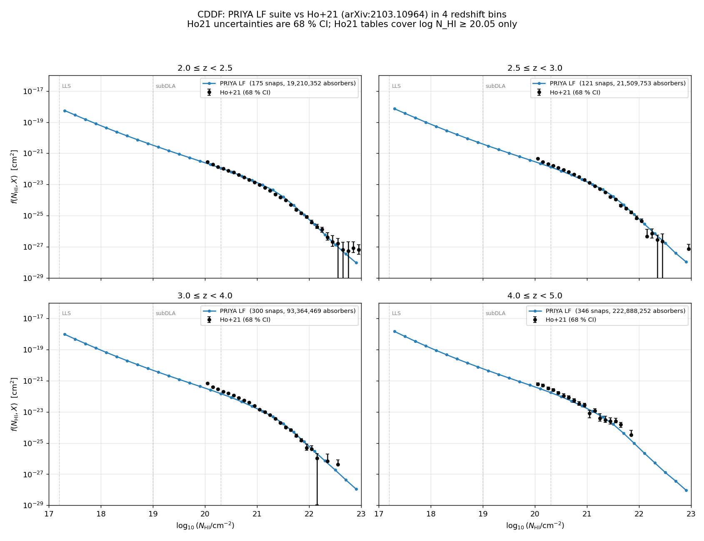

# hcd_priya: a Lyman-α forest P1D emulator with high-column-density absorber classes


[](https://github.com/jibanCat/hcd_priya/actions/workflows/tests.yml)

This repository holds the code of an emulator of the one-dimensional flux power spectrum
(P1D) of the Lyman-α (Lyα) forest that models the high-column-density (HCD)
absorbers contaminating it, together with the research pipeline it was built
for: measuring two cosmological parameters, the forest power amplitude A_p and
the tilt n_s, from the P1D. The supported interface of this release is the
predictor of the per-class P1D; the measurement itself is research code that does
not run at this commit (see
[Scope and limitations of this release](#scope-and-limitations-of-this-release)).
It is built on the PRIYA suite of cosmological hydrodynamic simulations.

This document describes what the project does, how to set up the two software
environments it requires, how to run the smallest useful piece, and what each
stage of the pipeline produces. Each stage is illustrated with the figure it
generates.

---

## What this is

<!-- docs:about:start -->
The Lyα forest is the series of absorption lines seen blueward of a distant
quasar's Lyα emission, each produced by intergalactic hydrogen along the line of
sight. The statistics of that absorption, and in particular its one-dimensional
power spectrum P1D(k), trace the small-scale clustering of matter, which in turn
constrains the primordial power spectrum (A_p, n_s) together with the nature of
dark matter and neutrinos.

A fraction of sightlines, however, intersect dense gas systems. These are the
Lyman-limit systems (LLS), the sub-damped and damped Lyα absorbers (subDLA and
DLA), known collectively as HCDs. They imprint broad damped wings on the
spectrum and bias the measured P1D if they are not modelled. We split the three
classes by neutral-hydrogen column density N_HI (`hcd_analysis/catalog.py`):
LLS at 10^17.2–10^19, subDLA at 10^19–10^20.3, and DLA at N_HI ≥ 10^20.3 cm⁻².
The pipeline measures P1D from the PRIYA simulations and trains a fast
differentiable emulator that carries an explicit free-amplitude model of the HCD
contamination. The research code then feeds that emulator into a gradient-based
likelihood, with the aim of inferring (A_p, n_s) while marginalising over the HCD
incidence; that last step is not part of this release. Treating
the HCDs correctly is what allows a forest P1D analysis to remain unbiased at the
sub-percent precision that DESI now delivers.

PRIYA: Bird, Fernandez, Ho et al. 2023, JCAP 10 037
([arXiv:2306.05471](https://arxiv.org/abs/2306.05471)); extended box from
Fernandez, Bird & Ho 2024, JCAP 07 029
([arXiv:2309.03943](https://arxiv.org/abs/2309.03943)).

hcd_priya is the continuation of the analysis of Ho et al. 2026,
"Small-scale Lyman alpha forest cosmology with PRIYA: constraints from XQ100 and KODIAQ-SQUAD one-dimensional flux
power spectra", JCAP 2026 (07) 094
([doi:10.1088/1475-7516/2026/07/094](https://doi.org/10.1088/1475-7516/2026/07/094),
[arXiv:2509.18271](https://arxiv.org/abs/2509.18271)). How to cite the software: [`CITATION.cff`](CITATION.cff).
<!-- docs:about:end -->

---

## Scope and limitations of this release

The supported public interface of this release is the predictor (`hcd_analysis.predictor`): the per-class P1D
(clean, LLS, subDLA, DLA) from an LF+MF model, and a linear mix of the HCD classes (`add_hcd`). The rest of the
repository (the catalogue pipeline, training, the likelihood and the fit scripts) is research code outside that scope.

Not in this release:

- **No cosmological inference.** No fit, sampler driver or supported likelihood runs from this repository at this
  commit (Stages 3 and 4 below; [`tests/DEFERRED.md`](tests/DEFERRED.md)).
- **No HCD fitting, and no model of how the HCD content changes with redshift.** `add_hcd` evaluates any physical
  amplitudes, one per class per redshift, and fits nothing; the incidence law and its priors are research code.
- **No prediction between snapshot redshifts.** Predictions exist at z = 2.0, 2.2, ..., 5.4 only; an LF+MF prediction
  is refused below the MF record's lower edge (z 2.2 by default) and flagged above z 4.6.
- **No bandpower model.** A prediction is a per-class spectrum at points in k: no metal lines, no
  spectrograph-resolution correction, no bin window, and no helper from a measured data leg to a model vector.
- **No calibrated emulator error.** `member_std` is the spread over ensemble members that differ only in their random
  seed; it is not an error bar and not a covariance.
- **No trained model, catalogue or derived product of this project is public yet** (see
  [Data and checkpoints](#data-and-checkpoints)).

---

## Install / environment

<!-- docs:install:start -->
**Supported environment.** Linux on x86-64, CPython 3.11, with the dependency versions pinned in
[`tools/ci/constraints-devenv.txt`](tools/ci/constraints-devenv.txt): the environment the test suite is developed
and run in. Other environments (newer dependency versions, Python 3.12 or later, macOS, Windows) are not supported
yet; [`docs/compatibility.md`](docs/compatibility.md) lists what is tested and what is not.

From a clone of this repository:

```bash
python3.11 -m venv .venv && source .venv/bin/activate
pip install -c tools/ci/constraints-devenv.txt ".[test]"    # the supported, pinned install
python -c "import hcd_analysis; print(hcd_analysis.__version__)"
hcd --help
```

**Working in a clone.** To run the scripts or the pipeline from the clone, install it editable instead:
`pip install -c tools/ci/constraints-devenv.txt -e ".[test]"`. The pipeline records the clone's commit, and only
an editable install makes that commit the code that runs (with your changes committed); a plain install runs the
copy made when it was installed.

The distribution is named `hcd-priya` (it is not on PyPI); it installs the `hcd_analysis` package and the `hcd`
command. `pyproject.toml` declares the dependencies, and `requirements.txt` only points to the install above.
Extras: `test` (pytest), `tutorials` (jupyter, nbformat) and `dev`.

The simulation side (building absorber catalogs and P1D from raw spectra) also needs `fake_spectra`, installed
separately ([`docs/fake_spectra_integration.md`](docs/fake_spectra_integration.md)); the emulator and the
likelihood do not. On the Great Lakes cluster, `bash scripts/install_greatlakes.sh` creates a conda environment
with both.

The emulator and the likelihood are written in JAX/Equinox and run on the CPU in double precision. Importing
`hcd_analysis.emulator` enables float64, which several structural identities of the model need: they hold only
to bit-level accuracy and break under JAX's default float32. Run scripts with:

```bash
JAX_PLATFORMS=cpu python <your_script.py>
```

The scripts under `scripts/` are not part of the installed package; run them from the repository root.
<!-- docs:install:end -->

---

## Data and checkpoints

<!-- docs:data:start -->
**Data availability.** The data products of this project are HCD absorber catalogues and the products derived from
them; it does not provide raw simulation data. Researchers who need the raw PRIYA simulation outputs can request them
from the authors of Bird et al. 2023, JCAP 2023 (10) 037
([doi:10.1088/1475-7516/2023/10/037](https://doi.org/10.1088/1475-7516/2023/10/037),
[arXiv:2306.05471](https://arxiv.org/abs/2306.05471)). The catalogues and derived products are not in this code
repository, and their release is planned but not yet available.
<!-- docs:data:end -->

The repository ships the code, not the data or the trained models. To set
expectations before the Quickstart:

- **The raw catalogs and skewers are not distributed here.** The PRIYA τ skewers
  and the per-(sim, snap) absorber catalogs are large and live on the cluster;
  they are gitignored (`outputs/`, `*.h5`). Building them is a Great Lakes job.
- **The full τ₀ training cache is not distributed here.** The v3.3 LF cache,
  `hcd_analysis/_emulator_data/observables_tau0_lf.h5`, is 1.1 GB and gitignored.
- **The trained checkpoints are not distributed here.** A checkpoint bundle is
  only ~6 MB, but its binary leaves (`checkpoints/*.eqx`, `*.norm.pkl`,
  `*.meta.json`) are gitignored, so a usable checkpoint is not present in a fresh
  clone either.

**Runtime data inputs.** The likelihood's observed P1D legs and the historical multi-fidelity resolution correction
are read from files the package does not ship. Each loader takes an explicit path; without one it reads the directory
an environment variable names, and with neither it stops and names the variable. There is no built-in path. Every
file is checked against the sha256 the package records before it is read, and a different file is refused
(`hcd_analysis.runtime_data`). An empty path, and a variable that is set but empty, are refused too. For DESI,
`use_snr3` (or `HCD_DESI_SNR3=1`) chooses the SNR>3 sample and an explicit path says where it is: a file of the other
sample is refused, never swapped. Each loaded leg records what it read (`leg.data_products`: the product, its version
and sha256, how the file was found and its path), and the likelihood's command-line entry points print one line per
verified file on stderr; in your own script, call `hcd_analysis.runtime_data.show_loads()` for the same lines.

| Variable | Holds |
|---|---|
| `HCD_P1D_DATA_DIR` | `desi_dr1_p1d/` (DESI DR1 P1D, SNR>1 and SNR>3 samples) and `eboss_dr14_p1d/` (eBOSS DR14 P1D) |
| `HCD_LYAEMU_PARENT` | `lyaemu/data/kodiaq_squad/` (KODIAQ-SQUAD P1D, conservative mode) |
| `HCD_KS_BASEDIR` | `res_corr/` (the historical multi-fidelity layer's resolution-correction table) |
| `HCD_LF_RAW_DIR`, `HCD_HR_RAW_DIR` | the LF and HiRes simulation outputs, used when the config file gives no `data_root` or `hires_data_root` |

What you need to run the emulator's low-level forward model yourself is modest:
a current-format trained checkpoint plus at least a slice of the current-format
τ₀ cache (one fold is enough to exercise the forward model on real cache rows);
neither is public. You do not need the full 1.1 GB cache or a cluster for that.
The likelihood needs more, and no inference driver runs at this commit (see
[Scope and limitations of this release](#scope-and-limitations-of-this-release)).

A data and model release is planned but not yet available (work in progress). The
natural home for the one-fold cache slice and a checkpoint is a dedicated data
repository, which the PI (M. Ho) will create; it is deferred for now. Until then,
request the checkpoint and a cache slice from the PI (mfho@umich.edu) or open an
issue. Please do not commit any large data or model artefacts to this code
repository.

### Release format of the emulator (HDF5 + JSON)

Emulator members are exported in a pickle-free, single-fidelity format, `hcd_priya.h5/2` (scope below; the
multi-fidelity correction is a separate record, see "LF+MF prediction" below): per member one HDF5 file (the network
weights as datasets named by their JAX tree paths, and the output normalizer) and one JSON sidecar (the meta and the
file's sha256), plus the map from absorber incidence (dN/dX) to the class weights w_c, and a bundle `manifest.json`
whose lineage block names the training cache,
its catalogues and the code. Loading builds the network from code, checks every array by name, shape and dtype,
verifies the sha256 before the HDF5 library parses the file, refuses a bundle whose lineage it cannot establish, and
never unpickles anything:

```python
from hcd_analysis.emulator import safe_h5
ensemble, metas, norm = safe_h5.load_ensemble("path/to/bundle", expected_manifest_sha256="<published digest>")
```

Most users load through the public predictor instead, which wraps this call and refuses an unanchored bundle:

```python
import hcd_analysis.predictor as hp
emu = hp.load_bundle("path/to/bundle", "<published digest>")
```

`load_bundle` serves **production** models only: every member must declare training on every simulation of its
training cache (verified against the cache at export and acceptance), and the bundle's w_c map must be fitted on the
whole cache. A bundle that declares fold or research members, or carries a fold map, is refused with a coded reason
(for example `ALL_SIMS_NOT_TRUE`, `RSV_KEY:recipe.holdout_sims`, `SIM_SET:recipe.train_sims` for a simulation list
under any key, or `WCMAP_NOT_FULL_CACHE`). Cross-validation folds
and other **research** models travel in research bundles (`scripts/export_research_bundle.py`, which needs a
repository checkout and refits the w_c map on the training simulations only) and load through their own explicit
path, never as production:

```python
rp = hp.load_research_bundle("path/to/research_bundle", "<its digest>", purpose="evaluate fold 3")
pred = rp.predict(params, 3.0, tau_eff=0.36)
pred.flags.get("research_model", False)             # True here; production predictions carry no such key
```

Arrays returned by `hp.add_hcd` do not carry the flag: keep the `Prediction` (or its `provenance`) with them.

**Scope: single fidelity.** An `hcd_priya.h5/2` bundle holds the members of one training cache and the w_c map fitted
to it, and no multi-fidelity (LF to HR) correction: loaded alone, a bundle trained on the low-fidelity cache gives
low-fidelity predictions; each prediction's labels say so (`product`, `mf_correction`). The multi-fidelity correction
is not part of this format: it is a separate MF record bound to one bundle, and an LF+MF release publishes the two
under one release manifest (next section). An `hcd_priya.h5/2` bundle alone is therefore not the complete release
model.

The files open with standard tools (`h5ls -r member.h5`). Contract and full usage: `docs/release_format_h5.md`; a
step-by-step guide to production and research bundles, with executable examples:
[`docs/tutorials/production_and_research_bundles.md`](docs/tutorials/production_and_research_bundles.md).

### LF+MF prediction (the multi-fidelity correction)

The low-fidelity (LF) emulator predicts the per-class P1D of the low-resolution PRIYA simulations. A multi-fidelity
(MF) record, fitted on matched high- and low-resolution simulation pairs, calibrates it to high resolution:
P_MF = P_LF exp(g(z, tau0, k)), where g does not depend on the cosmological parameters and is bound to exactly one LF
backbone bundle. The release MF record has been produced, and its grouped (K-fold) cross-validation results are
under review; no MF is released before that review is complete. The
calls below show the interface only; every path and digest in them is a placeholder.

```python
import hcd_analysis.predictor as hp
emu = hp.load_release("path/to/release", "<published release sha256>")    # release.json names both parts
# the same, with the two digests given directly:
emu = hp.load_bundle("path/to/release/backbone", "<backbone manifest sha256>",
                     mf_dir="path/to/release/mf", mf_record_sha256="<MF record sha256>")
pred = emu.predict(params, 3.0, tau_eff=0.36)                 # LF+MF: the default once an MF record is loaded
lf = emu.predict(params, 3.0, tau_eff=0.36, fidelity="LF")    # the LF backbone alone, bit for bit
pred.flags["mf_applied"], pred.provenance["mf"]["record_sha256"]
```

`provenance["mf"]` names the record, its composition and the rulings that set it, the fit commit, the mean-flux
convention of its targets (the settled global convention), the HR inputs used, the HR/LF mode-mapping check, the
lower edge of the MF's validation domain (`validated_z_min`, 2.2 by default; the domain edge, not a passed
validation), and the two cache digests with what each establishes:
the LF cache is lineage-verified through the backbone, while the HR cache is digest-anchored only and never
lineage-verified. Below the larger of the MF tables' lowest redshift and `validated_z_min` an LF+MF prediction is
refused (`MFRangeError`); ask for `fidelity="LF"` there. A bundle loaded without an MF record predicts exactly as before, and `fidelity="LF+MF"` on it
raises `MFUnavailableError`. Details: `docs/release_format_h5.md`, sections "The multi-fidelity record" and "The
release manifest".

Throughout the rest of this README, each stage is marked with what it needs:
**requires the full data / Great Lakes (not in this repo)** for anything that
builds the catalogs, the full cache, or trains the emulator;
**needs the release files** for the public predictor; and **research code** for
the likelihood and the fits, which do not run from this repository at this commit.

---

## Quickstart

**Needs the release files** (the LF backbone bundle, the MF record and `release.json`), which are not public yet; see
[Data and checkpoints](#data-and-checkpoints). Run it in the installed environment with `JAX_PLATFORMS=cpu`, as given
above.

The smallest end-to-end example loads a release, predicts the per-class P1D at one redshift and mixes in the HCD
classes. The path and the digest are placeholders: use the release directory and the sha256 published with it.

```python
import hcd_analysis.predictor as hp

# 1. load a release: the directory that holds release.json, and the sha256 published with it
emu = hp.load_release("path/to/release", "<published release sha256>")

# 2. the nine PRIYA parameters, by name; here the centre of the parameter box
params = {n: 0.5 * (lo + hi) for n, (lo, hi) in zip(hp.PARAM_NAMES, hp.PARAM_LIMITS)}

# 3. predict at one PRIYA snapshot redshift; the mean flux is (tau0_amp, dtau0), or tau_eff
pred = emu.predict(params, z=3.0, tau0_amp=1.0, dtau0=0.0)
print(pred.k.shape, pred.P_class.shape)    # (172,) (4, 172): k in s/km; P1D in km/s of clean, LLS, subDLA, DLA
print(pred.labels["product"])              # LF+MF

# 4. mix in the HCD classes, here with the model's own sightline fractions
P_total = hp.add_hcd(pred, pred.w_c)
print(P_total.shape)                       # (172,)
```

Read `pred.flags` before using the numbers: a parameter outside the training box, or an LF+MF prediction above
z 4.6, is returned and flagged, not refused. Without the release files, the same `predict` and `add_hcd` calls run on
a synthetic bundle (untrained networks, so it shows the interface and behaviour, not science):
`hcd_analysis.emulator.release_testing.write_synthetic_bundle` writes one that `hp.load_bundle` loads, and the
tutorial [`docs/tutorials/production_and_research_bundles.md`](docs/tutorials/production_and_research_bundles.md)
walks through production and research bundles on synthetic data. The low-level differentiable forward is described
in the emulator README linked below.

---

## HCD catalog construction (quickstart)

**Requires the full data / Great Lakes (not in this repo).** This step reads the
raw PRIYA τ skewers, which are large and not distributed here; it is a cluster
job. The structure of the products it describes can still be read for reference.

The HCD catalog is the foundation the rest of the pipeline rests on: it records,
for every PRIYA simulation and redshift, which sightlines intersect a dense
absorber and how much neutral hydrogen that absorber carries. From the catalog we
derive the column-density distribution function and the per-class P1D, and those
products are what the emulator is ultimately trained on.

The catalog is built directly from the optical-depth (τ) skewers produced by
`fake_spectra`. For each sightline, `hcd_analysis/catalog.py` locates connected
velocity regions where τ exceeds a detection threshold, merges regions separated
by less than a velocity gap, and estimates the column density N_HI of each system.
In production the column density is obtained by the sum-rule inversion (the fast
estimator, `absorber.fast_mode: true` in the config); a full Voigt fit with a
±2000 km/s wing window is available as an alternative. Each system is then placed
into one of three classes by its N_HI, with everything below the LLS threshold
discarded as forest:

- LLS:    10^17.2 ≤ N_HI < 10^19.0 cm⁻²
- subDLA: 10^19.0 ≤ N_HI < 10^20.3 cm⁻²
- DLA:    N_HI ≥ 10^20.3 cm⁻²

These boundaries are defined in `hcd_analysis/catalog.py` (`classify_system`), and
the detection and measurement parameters (τ threshold, merge gap, the N_HI floor)
live under `absorber:` in `config/default.yaml`.

Build the catalog as part of the per-simulation pipeline (`hcd_env`):

```bash
hcd run-sim --sim ns0.803Ap2.2e-09 --config config/default.yaml   # one sim, all snaps
hcd run-all --n-workers 36 --config config/default.yaml             # full 60-sim LF campaign
```

Each output root holds the results of one set of settings: the first run writes `run_settings.json` there, and a
later run with different settings, or into a root that holds files but no record, is refused before anything is
written (`hcd_analysis/run_settings.py`).

On Great Lakes the full campaign runs as a SLURM array, one task per simulation:

```bash
sbatch --array=0-59 scripts/batch_greatlakes.sh run-one-array
```

The input is the τ skewer HDF5 for each (sim, snap), read alongside the
`SimulationICs.json` that records the simulation's cosmology. The output is one
`catalog.npz` per (sim, snap) under `outputs/{sim}/snap_{NNN}/`, holding, for
every detected absorber, its sightline index, pixel range, N_HI, Doppler
parameter and class. The same run also writes the per-class P1D (`p1d.npz`) and
the per-snapshot CDDF (`cddf.npz`), which `cddf.py` stacks per redshift bin into
`cddf_stacked.npz`. Those per-class P1D and CDDF products, resampled across the
mean-flux ladder, are what `scripts/build_emulator_cache_tau0.py` assembles into
the τ₀ training cache described in Stage 1.

---

## The pipeline, stage by stage

> **A historical record, not a validation of a released model.** The stages, figures and numbers below describe the
> analysis campaign carried out with the historical emulator, which was trained on absorber catalogues made before the
> box-edge duplicate fix ([`docs/bugs_found.md`](docs/bugs_found.md), bug 8). They are kept as a record of that work.
> A released model will come with its own validation.

The pipeline has four stages, described in order. Each stage notes the product it
yields, shows the figure it produces, and gives the command that generated or
exercises it. `<emu-env>` below stands for `JAX_PLATFORMS=cpu python`, run from the
repository root in the installed environment ([Install / environment](#install--environment)).

### Stage 1 — the simulation P1D, absorber catalog and τ₀ cache

**Requires the full data / Great Lakes (not in this repo).** This stage reads the
raw PRIYA spectra and builds the 1.1 GB τ₀ cache; neither the inputs nor the
assembled cache is distributed here (both are gitignored).

The first stage turns raw PRIYA spectra into the products everything downstream
depends on: the per-sightline P1D, the absorber catalog (which sightlines
intersect an LLS, subDLA or DLA, as described in the section above), the
column-density distribution function CDDF = f(N_HI, X), and the per-class P1D
split between the clean forest and each HCD class. We resample these measurements
across a ladder of mean-flux rescalings to form the τ₀ cache that trains the
emulator. Here τ₀ is the mean-flux optical depth, τ₀ = −ln⟨F⟩; scanning it on a
ladder lets the emulator learn the mean-flux dependence directly.

This stage yields an absorber catalog, the per-class P1D and a CDDF for each
(sim, z), along with the assembled τ₀ training cache. The figure below compares
PRIYA's CDDF with the Ho et al. 2021 observations, a check that the simulated HCD
population is realistic.



Run it (catalog/P1D side, `hcd_env`):

```bash
hcd run-sim --sim ns0.803Ap2.2e-09 --config config/default.yaml   # one sim, all snaps
hcd run-all --n-workers 36 --config config/default.yaml             # full campaign
```

Build the τ₀ cache for the emulator:

```bash
<emu-env> scripts/build_emulator_cache_tau0.py     # -> hcd_analysis/_emulator_data/observables_tau0_lf.h5
```

### Stage 2 — the HCD-marginalised emulator

**Training requires the full data / Great Lakes (not in this repo)** — the LOSO
sweep needs the full τ₀ cache. **Using a released model needs only the release
files** (the [Quickstart](#quickstart) above). The emulator README's low-level
forward-model API needs a current-format checkpoint and a slice of the training
cache, neither of which is public.

A differentiable JAX/Equinox network learns the per-class P1D as a smooth
function of the cosmology θ, the redshift z and τ₀. The central design choice is
that the HCD contamination enters as a free per-class amplitude on top of the
clean forest, so that the inference can marginalise over the HCD incidence rather
than assuming the simulation reproduced it exactly. Before 2026-10 the emulator was
checked with leave-one-simulation-out (LOSO) cross-validation: for each fold it was
trained on all simulations but one and tested on the held-out simulation, which is
how its own error budget was estimated. The release validation is reported separately.

This stage yields a fast, autodifferentiable forward model
`P_obs(θ, z, τ₀, α_HCD)`. Its held-out error is measured per fold as a Fisher
bias: the emulator residual projected onto the directions the data actually
constrain (the Fisher-information eigendirections) and read off as a cosmology
shift in units of σ along those directions; this is the cosmology-relevant bias
rather than a raw spectral error. The results are reported with the release
validation, which is not public yet.

Train it (the 8-fold LOSO sweep; `--smoke` for a fast shape check):

```bash
<emu-env> scripts/run_loso_sweep.py --out checkpoints/final --histdir checkpoints
```

The emulator has its own detailed README, covering the architecture, the τ₀
ladder, the forward model, the conventions and the input contract. It is the
reference for anything emulator-specific:
[`hcd_analysis/emulator/README.md`](hcd_analysis/emulator/README.md).

### Stage 3 — the differentiable likelihood

**Research code; not runnable from this repository at this commit.** The likelihood
is a Python/JAX API on top of the emulator. Its inputs (training checkpoints, the
training cache and the emulator-error products) are not distributed, and no script
here evaluates it on a data leg. What runs is the likelihood on synthetic inputs,
in the test suite.

The emulator's `P_obs` is wired into a Gaussian log-likelihood that compares the
prediction to the data (the DESI DR1 and KODIAQ-SQUAD P1D) through an
emulator-error covariance and physically motivated priors. The HCD incidence
prior is centred on the observed dN/dX rather than the simulation's; it was
designed so that an incorrect prior centre should not propagate into the
cosmology, which is a check of that research path (below).

As research code, this stage yields a fully differentiable log-posterior suitable
for a gradient sampler, together with the HCD-incidence prior; neither is part of
the supported interface of this release. Whether a mis-centred incidence
prior shifts the cosmology is a check of that research path, not of this release.

The likelihood is a Python API rather than a one-shot script. The snippet below
shows the import only; it does not produce output on its own, and the full call
signature is given in the emulator README §8 and §5:

```python
from hcd_analysis.emulator.inference import log_lik_multiz, hcd_incidence_prior
# illustrative import only — full call signature in the emulator README §8 / §5
```

### Stage 4 — inference and closure

**Research code; no inference driver runs at this commit.** The fit and closure
scripts in `scripts/` call interfaces that the 2026 k-grid fix retired
([`tests/DEFERRED.md`](tests/DEFERRED.md)); rebuilding them is follow-up work. The
paragraphs below describe the method and the runs made before 2026-10.

The final stage samples the posterior with NUTS, the No-U-Turn Sampler, a
gradient-based MCMC method that exploits the differentiable likelihood. Before
2026-10 the pipeline was checked with closure tests: mock data drawn from a known
truth were fitted to confirm that it is recovered within the stated error bars. Closure on
mocks and on public archival data (eBOSS DR14, KODIAQ-SQUAD) may be committed;
any DESI cosmology result stays local and blinded.

This stage is designed to yield posterior constraints on (A_p, n_s) and a closure
verdict: how many of the held-out mocks recover the truth within ±1σ, and whether
the sampler diverges. It does not run at this commit, and no fit or closure result
is part of this release.

What these closures do and do not certify is worth stating plainly. Before 2026-10
they checked the architecture, that is the forward model, the covariance and the
sampler, that the production all-sims N=5 ensemble inherits. The ensemble-level production SBC
(rank-based simulation-based calibration on the production ensemble itself) is the
final inference-calibration gate of that research path; neither it nor a fit to
real data is part of this release.

The SBC / closure machinery (PIT-ECDF bands, coverage, whitening tests) lives in
`hcd_analysis/emulator/closure_diagnostics.py`; the validation writeups of that
research path are not public and are not part of this release.

---

## Where to go next

- To report an issue, ask for help or contribute: [`CONTRIBUTING.md`](CONTRIBUTING.md).
- The emulator deep-dive covers the architecture, the τ₀ cache, the training
  recipe, the forward model, the input contract and the conventions:
  [`hcd_analysis/emulator/README.md`](hcd_analysis/emulator/README.md).
- The tutorials are five short notebooks that introduce the per-(sim, snap) HCD
  data products from the ground up, with a recommended reading order:
  [`notebooks/tutorials/README.md`](notebooks/tutorials/README.md).
- The science walkthrough and the record of bugs found on the catalog/P1D side
  are in [`docs/analysis.md`](docs/analysis.md),
  [`docs/bugs_found.md`](docs/bugs_found.md),
  [`docs/data_layout.md`](docs/data_layout.md) and
  [`docs/p1d_definition.md`](docs/p1d_definition.md).
- The validation results (held-out LOSO error, coverage and the Fisher checks)
  are not public yet; the closure gates belong to the research path and are not
  part of this release.

---

## Tests / status

Install the test extra (above), then run a test file with pytest, one file per process:

```bash
JAX_PLATFORMS=cpu python -m pytest -q tests/test_cli_config.py
```

Many tests need real assets that are not in this repository (the training cache, trained emulator members,
observational data, raw simulation outputs). [`tests/ci_tiers.toml`](tests/ci_tiers.toml) assigns every test
file to a tier and says why a file or test is not run in continuous integration. The workflow
[`.github/workflows/tests.yml`](.github/workflows/tests.yml) builds the wheel and the source archive, checks
their contents against the commit, installs the wheel into a fresh environment and runs the "wheel" and "source"
tiers with [`tools/ci/run_test_tier.py`](tools/ci/run_test_tier.py), which reports every skipped, deferred or
deselected test as not run, never as passed. The same runner works from a clone:

```bash
JAX_PLATFORMS=cpu python tools/ci/run_test_tier.py --tier source --out <new_results_dir>
python tools/ci/run_test_tier.py --list-not-run
```

Status: research code under active development. The validation results are not public yet.

---

## Repository map

```
hcd_analysis/            catalog/P1D/CDDF pipeline (catalog.py, p1d.py, cddf.py, hcd_template.py, ...)
hcd_analysis/emulator/   the JAX/Equinox emulator + likelihood + inference (see its own README)
hcd_analysis/cli/run.py  the `hcd` command-line entry point
config/default.yaml      default pipeline config
scripts/                 install, SLURM batch, cache build, LOSO sweep, plotting
notebooks/tutorials/     five starter notebooks for new students
tests/                   science-claim regression tests
docs/                    analysis.md, bugs_found.md, data_layout.md, handover, ...
figures/analysis/        all analysis + validation figures
checkpoints/             trained emulator bundles (final_fold0.*) + error_vector.npz — gitignored, not in this repo (see Data and checkpoints)
hcd_analysis/_emulator_data/  the 1.1 GB τ₀ cache — gitignored, not in this repo (see Data and checkpoints)
```
