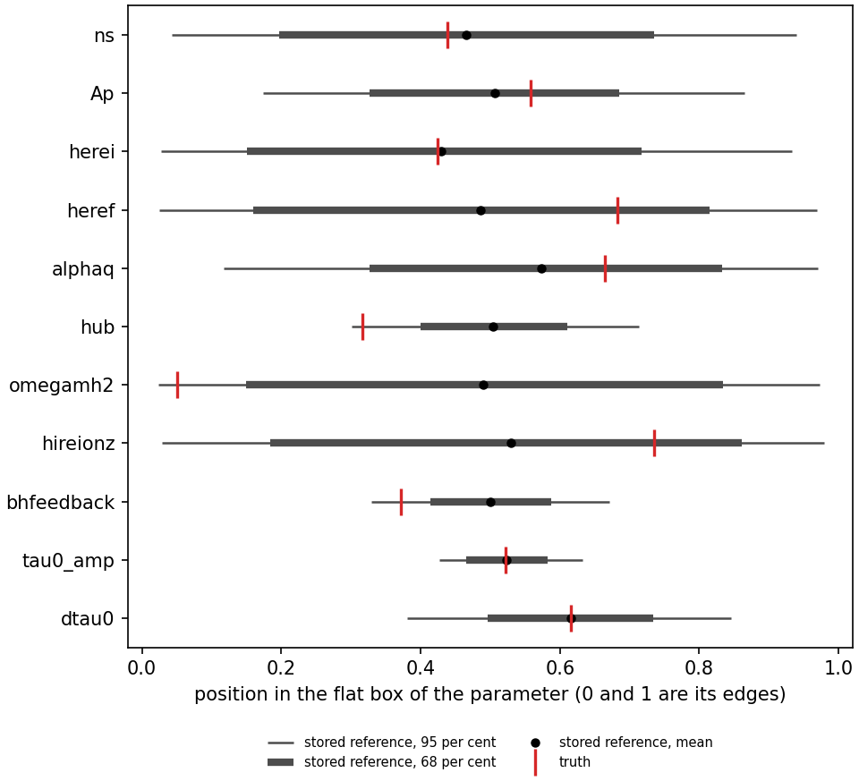
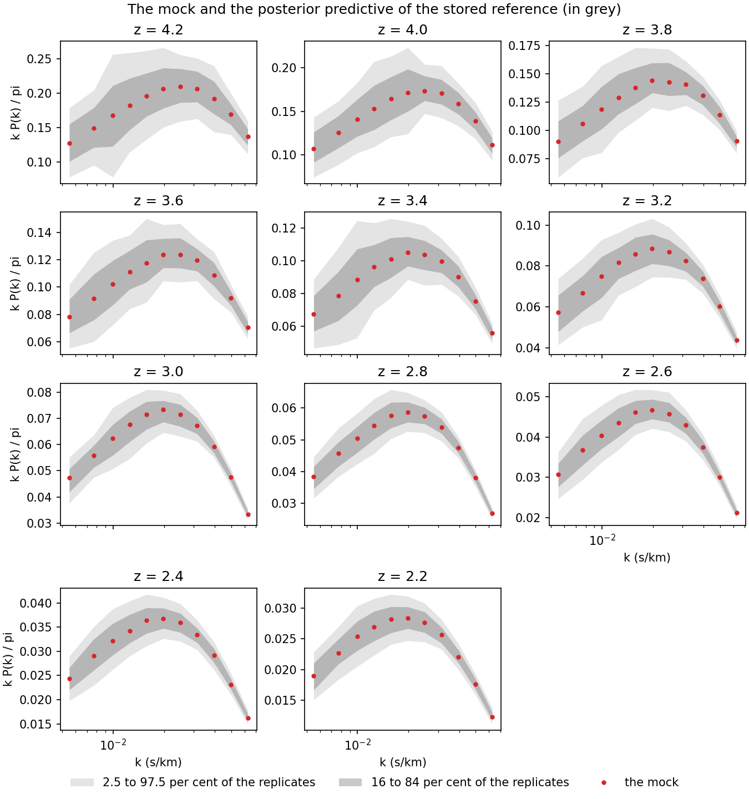

# The Gaussian data likelihood and the mock-recovery example

`hcd_analysis.likelihood` turns a loaded model and a P1D data set into a log likelihood. **It is a data likelihood:
the covariance C is the data set's own, and no emulator error is added to it.** It is not a likelihood of "data plus
emulator": the model is treated as exact, so a posterior from it is narrower than one that accounts for the error of
the emulator. This page gives the mathematics step by step, says what is left out, and how the example that comes
with it is run. The reference of every function is on the [API page](api.md).

**Nothing is fitted to a measurement by anything on this page.** The example recovers the parameters of a mock, a
data vector made from a simulation at a known point. No mock and no model is published yet. The example reads them
from the example download described below, which is not published yet, or from files you name.

## The mathematics, step by step

A point $\theta$ is the nine PRIYA parameters (`predictor.PARAM_NAMES`) and the two mean-flux parameters `tau0_amp`
and `dtau0`, written $\tau_0$ and $d\tau_0$ below. A data set has redshifts $z_i$, at each redshift the wavenumbers
$k_{ij}$ of its bins (angular, in s/km), the data vector $d$ of length $N$ (km/s), its covariance $C$ ($N \times N$),
and optionally a factor $F$ (one number per bin). `GaussianP1DLikelihood.loglike(theta)` computes:

1. **The mean flux.** At each redshift of the data, PRIYA's two-parameter model of the effective optical depth
   (`predictor.tau_eff_priya`):

   ```math
   \tau_\mathrm{eff}(z) = \tau_0 \left( \frac{1 + z}{1 + z_\mathrm{pivot}} \right)^{d\tau_0} \tau_\mathrm{Kim}(z),
   \qquad \tau_\mathrm{Kim}(z) = 0.0023 \, (1 + z)^{3.65},
   ```

   with $z_\mathrm{pivot} = 3$; $\tau_\mathrm{Kim}$ is the fit of Kim et al. (2007).

2. **The class spectra.** The predictor gives, at each $z_i$, the P1D of the four classes of sightlines, $c$ = clean,
   LLS, subDLA, DLA: $P_c(k_n)$, on the model's own wavenumbers $k_n$ (its "modes", step 4).

3. **The mixture.** One spectrum per redshift, as `predictor.add_hcd` forms it:

   ```math
   P_\mathrm{model}(k_n) = P_\mathrm{clean}(k_n) + \sum_c A_c \left[ P_c(k_n) - P_\mathrm{clean}(k_n) \right],
   ```

   with $c$ over LLS, subDLA and DLA, where $A_c$ is the fraction of all sightlines that belong to class $c$ (each
   in [0, 1], their sum at most 1; the rest is clean forest). By default $A_c$ is the model's own fraction at the
   point, `pred.w_c`, so the HCD content follows the nine parameters; the section on the HCD content gives the two
   other ways.

4. **The model at the data's wavenumbers.** `interp_to_bins` takes $P_\mathrm{model}$ at each $k_{ij}$ by linear
   interpolation between the two neighbouring modes, $k_n \le k_{ij} \le k_{n+1}$:

   ```math
   m_{ij} = P_\mathrm{model}(k_n) + \left[ P_\mathrm{model}(k_{n+1}) - P_\mathrm{model}(k_n) \right]
   \frac{k_{ij} - k_n}{k_{n+1} - k_n}.
   ```

   A data wavenumber outside the modes is refused (the next section says more).

5. **The factor.** With a factor, $m_{ij}$ is multiplied by $F_{ij}$ (for example a resolution table that the data
   also carry). The result, joined redshift by redshift in the order of $d$, is the model vector $m(\theta)$.

6. **The residual.** $r = d - m(\theta)$.

7. **The Gaussian.** With $C_\mathrm{sym} = (C + C^T) / 2$ ($C$ itself when it is symmetric; a covariance may differ
   from its transpose by rounding, `SYMMETRY_RTOL`) and its Cholesky factor $L$, $C_\mathrm{sym} = L L^T$, computed
   once:

   ```math
   r^T C^{-1} r = \left| L^{-1} r \right|^2, \qquad \ln \det C = 2 \sum_i \ln L_{ii}
   ```

   (one triangular solve; no inverse is formed), and

   ```math
   \ln \mathcal{L} = -\frac{1}{2} \, r^T C^{-1} r - \frac{1}{2} \ln \det C - \frac{N}{2} \ln (2 \pi).
   ```

   `chi2(theta)` returns $r^T C^{-1} r$; `loglike(theta)` returns $\ln \mathcal{L}$.

8. **Gaussian terms on parameters,** when the likelihood is made with them (`gaussian_terms={name: (mean, sd)}`):
   each adds, for the value $x$ of its parameter,

   ```math
   -\frac{1}{2} \left( \frac{x - \mathrm{mean}}{\mathrm{sd}} \right)^2 - \ln \left( \mathrm{sd} \sqrt{2 \pi} \right).
   ```

   `logp(theta)` is $\ln \mathcal{L}$ plus these terms; `loglike` has none of them.

9. **The flat boxes** are not in the likelihood: they belong to the sampler. The example gives its sampler a flat
   prior on each of the eleven parameters (`BOXES` in the script) and the two Gaussian terms on `hub` and
   `bhfeedback` (`GAUSSIAN_TERMS`), and samples `sampler_logp`.

## Bringing the model to the data's wavenumbers

**The algorithm** is step 4 above and nothing more: the straight line between the two neighbouring modes, evaluated
at each data wavenumber. It is `interp_to_bins`, whose body is that line (through `numpy.interp`) after two small
checks. It is not a re-binning and not an average over the width of a bin, and nothing in it is fitted or tuned: it
is the value of the model AT the data wavenumber.

**Why this is enough for the data this package was tried with.** The modes are the box modes of the PRIYA
simulations, `k_n = 2 pi n / (120 Mpc/h)`, n = 1 to 172. In s/km they depend on z and on `hub` and `omegamh2`; at the
midpoint of the parameters their spacing is 0.00052 s/km at z = 2.2 and 0.00042 s/km at z = 4.2 (0.00040 to 0.00055
over the corners of `hub` and `omegamh2`), and they reach 0.068 to 0.095 s/km. The data bins, from the public files:

| Data set | Bins | Spacing of the bins | Modes per bin |
|---|---|---|---|
| eBOSS DR14 (Chabanier et al. 2019) | 35 per redshift, 0.00108 to 0.0195 s/km | 0.000542 s/km, uniform | about 1 |
| KODIAQ-SQUAD (Karacayli et al. 2022) | 21 per redshift: 0.0011 to 0.0077 s/km in steps of 0.0022, then steps of 0.1 in log10 k to 0.40 s/km | 0.0022 to 0.081 s/km | about 4 at the lowest k, many more above |
| XQ-100 (`load_xq100`) | 13 per redshift, 0.00316 to 0.0631 s/km | 0.108 in log10 k (0.0009 to 0.014 s/km) | about 2 at the lowest k, many more above |

Where the data bins are a few modes apart or more, the model is a smooth function sampled finely, and the line
between two modes is close to it. Where a bin is about one mode wide (eBOSS), the value at the bin centre and the
average over the bin can differ, and this rule takes the value at the centre.

**The situations to avoid:**

- **Bins wider than the mode spacing, compared with a bin average.** If a data set reports the average of the power
  over a wide bin, a point value of the model at the bin centre is not the same thing where the spectrum curves.
  Give the data's own window as `model_factor` only if it is a multiplicative factor; a true bin average is not
  computed here.
- **The lowest wavenumbers.** Below about 0.003 s/km a data bin holds only a few modes. The first mode lies between
  about 0.0004 and 0.0006 s/km, depending on the point: a data bin below about 0.0004 s/km is refused at every
  point, and one between 0.0004 and 0.0006 s/km at some points.
- **Data beyond the modes.** A data wavenumber below the first or above the last mode at a point is refused
  (`OutsideModesError`), never extrapolated. The modes move with `hub` and `omegamh2`, so a bin near an end can be
  inside the modes at one point and outside at another: `sampler_logp` returns minus infinity there. Keep the data
  well inside the modes over the whole box (the KODIAQ-SQUAD bins above about 0.07 s/km are outside them at some
  points of the box).
- **Features finer than the mode spacing.** The model is known at its modes only: a feature narrower than about two
  mode spacings is not resolved by interpolating it.
- **Features the model does not have.** Interpolating never creates a feature that is not in the model. For example
  the oscillation of the SiIII-Lyman-alpha cross term (period 2 pi / 2271 km/s = 0.0028 s/km, five to seven mode
  spacings, so the modes would resolve it) is not in the class spectra: such a term must be part of the model or of
  the data's treatment, not of this rule.

## The HCD content: three ways, each explicit

| How | What a value means | 0 means | 1 means |
|---|---|---|---|
| neither argument (the default) | A_c = the model's own fraction at the point, `pred.w_c` | (no value to give) | (no value to give) |
| `hcd_fractions={"LLS": a, "subDLA": b, "DLA": c}` | the ABSOLUTE fraction of all sightlines in that class, in [0, 1], at most 1 in sum | no sightline of that class | every sightline in that class |
| `hcd_relative_to_priya={"LLS": r1, "subDLA": r2, "DLA": r3}` | a factor on the model's own fraction: A_c = r_c `pred.w_c`, each r_c >= 0 | no sightline of that class | the model's own fraction |

Each argument is a mapping that names the three classes, so a value cannot land on the wrong class; a value is one
number, or one per redshift of the data. Give at most one of the two. A list, an unknown or missing class, a value
out of its range, or both arguments are refused when the likelihood is made. Writing 1 for each class in
`hcd_fractions` (where 1 means "every sightline") is refused because the fractions would sum to 3. Not every
mistake can be caught: small values meant as absolute fractions but given to `hcd_relative_to_priya` (for example
0.02) are valid factors and are accepted, as is a single class at an absolute fraction of 1. With
`hcd_relative_to_priya` the scaled fractions can sum to more than 1 at some point; the predictor refuses that point
(minus infinity in a sampler).

## What is not in it

- **No emulator error.** C is the data set's covariance, as given: this is a data likelihood. The model is treated as
  exact, so a posterior from it is narrower than one that accounts for the error of the emulator.
- **No bandpower model, no resolution model, no metals, no continuum or DLA-masking systematics** beyond what a data
  set puts into its covariance and its `model_factor`.
- **The two omissions of the mixture** stated on a prediction (`pred.labels["omissions"]`): the power of the subDLA
  cores that the PRIYA filter removes, and the DLA damping-wing core.
- **No prior.** Flat boxes belong to the sampler. Gaussian terms on parameters can be given when the likelihood is
  made; `logp` adds them and `loglike` does not.

**Why the example's stored reference uses the data covariance alone.** The example is a recovery test: the mock is
made from a simulation that the model never saw, and the question is whether the model recovers the point the mock
was made at. In such a test the error of the emulator is the thing being measured. With the data covariance alone,
any error of the emulator shows up as a shift of the posterior against the truth, and that shift is what the stored
reference reports. Adding an emulator term to C would widen the posterior and make the same test more lenient. For a
fit to a measurement you may want an emulator term. This module does not add one; a covariance is used as it is
given, so you can add such a term to the covariance of your data set before you make the likelihood.

## When a sampler gets minus infinity

`sampler_logp(theta)` returns `logp(theta)` or minus infinity, and counts every minus infinity in `refusals` by kind,
with its first message. At the defaults, for a point whose eleven values are real numbers, it returns minus infinity
in exactly the cases listed in `SAMPLER_REFUSALS`, each a refusal for correctness (no number exists there):

- the predictor refuses the point (`PredictorInputError`): a parameter is not finite; or `tau_eff(z)` is not
  positive at a redshift of the data (`tau0_amp <= 0`); or, with `hcd_relative_to_priya`, the scaled fractions sum
  to more than 1;
- a data wavenumber lies outside the model's modes at the point (`OutsideModesError`);
- the model's spectrum is not finite at a redshift of the data (`NonFiniteModelError`): the predictor serves, and
  flags, a mean flux outside the range it was trained on, and far outside it (for example `tau0_amp` in the hundreds,
  or a `dtau0` that makes `tau_eff(z)` overflow) the spectrum can stop being finite.

**Not minus infinity:** a point outside the box the model was trained on or the package's sampling box, on the n_s
ridge, with a mean flux off the trained ladder (unless so far off that the spectrum is not finite), or where the
tables of the multi-fidelity correction are clamped. The
predictor serves such a point and sets a flag (`like.prediction(theta).flags`). At the defaults there is therefore
nothing to relax. To study these edges:

- `refuse_flags=("outside_sampling_box",)` (any flag names) makes `sampler_logp` return minus infinity wherever one of
  the named flags is set, counted as `flag:<name>`. It changes the posterior and emits a `DiagnosisOnlyWarning`: it
  is for diagnosis only, for example a chain with and one without the switch.
- `fidelity="LF"` makes a likelihood without the multi-fidelity correction: compare the two to see its effect.
- The flat boxes of the example (`BOXES`) can be widened: the predictor flags, and does not refuse, points outside
  them.

**Still raised, not minus infinity:** a point with missing or unknown names, or with a value that is not a real
number (text, True or False, a list); a fidelity the model cannot serve and a
data redshift below the multi-fidelity correction (`MFUnavailableError`, `MFRangeError`), which hold for every point,
so minus infinity everywhere would hide the reason; a name in `refuse_flags` that is not a flag of a prediction,
or whose value is not True or False.

## A data set

`P1DData` holds the redshifts, the wavenumbers per redshift (angular, in s/km), the data vector, the full covariance,
an optional factor on the model vector, the truth of a mock and a free-form provenance. `write_p1d_data` writes one
as a strict JSON file with one covariance block per redshift, and `read_p1d_data` reads it only against its sha256.

```python
import numpy as np
from hcd_analysis.likelihood import GaussianP1DLikelihood, P1DData

# emu is a loaded model, params the nine parameters by name (see the README's first example).
theta = dict(params, tau0_amp=1.0, dtau0=0.0)
pred = emu.predict(params, z=3.0, tau0_amp=1.0, dtau0=0.0)
k = 0.5 * (pred.k[:-1] + pred.k[1:])            # wavenumbers halfway between the model's modes
n = k.size
blank = P1DData.from_blocks(z=[3.0], k=[k], p1d=[np.ones(n)], cov_blocks=[np.eye(n)])
made_at = GaussianP1DLikelihood(emu, blank).model_vector(theta)
mock = P1DData.from_blocks(z=[3.0], k=[k], p1d=[made_at], cov_blocks=[0.01 * np.eye(n)], truth=theta)
like = GaussianP1DLikelihood(emu, mock)
print("chi2 at the point the mock was made at:", like.chi2(theta))
```

```text
chi2 at the point the mock was made at: 0.0
```

The docstring of `GaussianP1DLikelihood` holds this example, and a test runs it on a synthetic model.

## A stored reference

`P1DReference` holds what a figure needs to show a chain against a reference posterior for a mock, and nothing
else: for each parameter the truth, the posterior mean and the central 68 and 95 per cent intervals; and for each bin
of the data vector some percentiles of the posterior predictive. It holds no chain, no covariance and no likelihood
value. `write_reference` writes one as a strict JSON file and `read_reference` reads it only against its sha256, as
for a data set. `reference.check_bins(data)` refuses a data set whose redshifts and wavenumbers are not exactly the
reference's, and `reference.band(16, 84)` returns two stored percentile rows; nothing is interpolated between stored
levels. How a reference was made is stated in its `provenance`, which the class carries and does not interpret.

## The example: `examples/mock_recovery.py`

```text
python examples/mock_recovery.py --download DOWNLOAD_DIR
python examples/mock_recovery.py --download DOWNLOAD_DIR --demo 200 --out out/
python examples/mock_recovery.py --release RELEASE_DIR SHA256 --data MOCK_FILE SHA256
```

The first two lines read the mock, its model and the stored reference from the example download (next section). The
third runs on a model and a mock of your own, and then has no stored reference.

- **Part 1** prints the chi-square and the log likelihood at the point the mock was made at, and the flags of that
  point. Every line is labelled.
- **Part 2** needs Cobaya, which is not a requirement of the package (`pip install cobaya`). `--demo N` runs one
  short chain of N accepted steps and labels it "A DEMONSTRATION CHAIN, NOT CONVERGED": its numbers are not results.
  `--full` runs one chain with the settings written out in the script until Cobaya's own convergence test stops it.
  Either chain starts at the truth of the mock, and the script says so; it is a single process and refuses to run
  under MPI. A sampler lets INFO records pass, so the predictor's record of the corrections it applies appears in the
  sampler's output: once, because the library writes it once per predictor and at DEBUG afterwards. Without Cobaya
  the part says so and is skipped.
- **Part 3** draws the figures. After a chain: the posterior predictive of the data vector, `posterior_predictive.png`
  (model vectors at points of the chain, each with one replicate of the data drawn from the covariance). With the
  example download the stored reference is drawn underneath in grey (its 2.5 to 97.5 and 16 to 84 per cent bands),
  and `draw_reference` draws two more figures from the stored reference and the mock alone (shown below, in the
  section on the download): `posterior_intervals.png`, for each of the eleven parameters the reference's mean, its
  68 and 95 per cent intervals and the truth, each on the scale of the parameter's flat box, with the 16th to 84th
  percentile of the chain of the run over it; and `posterior_predictive_per_redshift.png`, the mock at each
  redshift with the stored bands of the posterior predictive. Each of the two has a side file (`.json`) that says
  in words what it shows and from which items of the download. The part also prints the reference's mean and 68
  per cent interval of each parameter, labelled. Without a chain the figures show the stored reference alone. A
  `--demo` chain drawn over the reference is labelled NOT CONVERGED in the figures: the reference is a converged
  posterior, a demonstration chain is not, and the two are not expected to agree.

What the example fixes is written out at the top of the script:

- **The flat boxes of the eleven parameters:** the parameter limits of Table 2 of Fernandez, Bird and Ho (2024),
  read in the arXiv version. The two helium reionisation redshifts use the package's own sampling box, which is
  narrower than the box the model was trained on. `alphaq` is sampled to 3.0, the edge of the trained box and
  beyond the package's own sampling box (2.5), where the training simulations are sparse. `ns` is sampled to 1.05;
  above 0.995 the training simulations are sparse too, and the predictor flags such a point (`ns_ridge`).
- **Two Gaussian terms,** on `hub` (mean 0.70) and `bhfeedback` (mean 0.05), which this kind of data does not
  constrain. Their standard deviations are 0.015 / sqrt(2) and 0.005 / sqrt(2), narrower by sqrt(2) than the widths that
  Fernandez, Bird and Ho (2024) quote: they are the widths of this project's own reference chains for such a mock.
  The chains are not shipped; the stored reference of the example download is a summary of one of them.
- **The sampler settings of `--full`:** Cobaya's Metropolis sampler, one chain, stopped at R-1 < 0.01 for the means
  and R-1 < 0.05 for the bounds; the first 30 per cent of a chain is dropped before anything is read from it. The
  project's reference chains ran four chains; this script runs one.

A research (fold) model of your own, trained without the simulation your mock comes from, is loaded with
`--research`, its fold MF record with `--mf` and an incidence record built without that simulation with
`--incidence`.

## The example download

**It is not published yet.** Where it will be hosted is decided with the release; until then the example runs only
on a model and a mock of your own. This section says what the download is, so that the script and the files can be
checked against each other when it exists.

The download is one directory. `--download DIR` names it, or the environment variable `HCD_PRIYA_EXAMPLE_DOWNLOAD`
when no model is named on the command line. Its items, each with the sha256 it must have (the values are also
written in the script, as `DOWNLOAD`):

| Item | Place in the directory | What it is | sha256 |
|---|---|---|---|
| `mock` | `mock.p1d.json` | The data set: the P1D of one PRIYA high-resolution simulation, named in the file's provenance and one of the three high-resolution runs listed in `Emulator_Files/hires/emulator_params.json` of the public repository `jibanCat/InferenceLyaData`, at 9 redshifts and 11 wavenumbers each (99 bins), times a resolution table, with a covariance per redshift derived from the KODIAQ-SQUAD P1D of Karacayli et al. (2022), and the truth. No measured P1D is in it. Its provenance names the inputs | `95b155c00600499618f826e8f5b660c917c16b9bd73e32099201ca49cdd88a0d` |
| `model` | `model/` | A research bundle: a fold model, trained WITHOUT the simulation of the mock. The sha256 is that of its `manifest.json`, which names every other file of the bundle by its own sha256 | `f8a830af3faaffc4f47d90f2fc596d4d8cc9760fc3057127da22cea0771638e2` |
| `mf_record` | `mf_record/` | The fold's MF record, built without that simulation. The sha256 is that of the record | `e639c4b187eface66e5e99bad1efe5645e409fe916f353cd0ef2f88d97bc2fa5` |
| `incidence_record` | `incidence_record/` | The fold's incidence record, built without that simulation. The sha256 is that of the record | `094522ca1a44f153f6661df5e7eed8211ce836c6864f779021271c109e2eb02f` |
| `reference` | `reference.json` | The stored reference: a summary of a converged posterior for this mock on this model, and its posterior predictive band | `bf74d07bf3326bd3952515b852e99e3202f8c1b4cc69253dfb19700f58923807` |

- **The model is not the release model.** It is one fold of the cross-validation, trained without the simulation
  the mock was made from, so that the recovery is a held-out one. It loads only through `load_research_bundle`, with
  a stated purpose. Do not use it for anything but this example.
- **What is checked.** The directory holds a manifest, `example_download.json`, that states the format
  (`hcd_priya.example_download/1`) and the five sha256. The script refuses a directory whose manifest states
  anything else: it was made for another version of the script. The manifest is a first check only. What protects
  the read is that each loader refuses an item whose sha256 is not the one written in the script, and that the
  reference must be on the bins of the mock, state the mock's truth and hold the percentile levels the figures
  draw. Every such refusal ends the script with one line that starts with "refusing:".
- **What the stored reference holds, and nothing more:** the truth of the mock, the posterior mean and the central
  68 and 95 per cent intervals of the eleven parameters, and the percentiles 2.5, 16, 50, 84 and 97.5 of the
  posterior predictive on the 99 bins. It comes from the project's own reference chains for this mock: Cobaya's MCMC
  sampler, four chains, stopped at R-1 below 0.01 for the means and below 0.05 for the 95 per cent bounds, the first
  30 per cent of each chain dropped; the flat boxes and the two Gaussian terms of the example; the model and the mock
  of the download. The predictive percentiles are over 1,000 posterior draws of a replicate of the data vector (the
  model vector at the draw plus noise from the data covariance). The chains were sampled with the project's private
  reference likelihood, not with this module; the two were compared on the fold models and mocks of two runs (the
  run of this example, and before it another high-resolution run) and agree: to rounding at the truth, and at the
  printed precision of the reference chain files at 32 points of the prior box each.
- **What the reference is not.** No emulator error is in the covariance, so its intervals are narrower than ones
  that account for the error of the emulator. It is one mock on one model: it says that the pieces recover a known
  point of a simulation, and nothing about any measurement.

### The stored reference, drawn

The two figures below are drawn by `draw_reference`, in part three of the example, from the stored reference and
the mock of the download alone: no model, no chain. With the download, `python examples/mock_recovery.py --download
DOWNLOAD_DIR` writes the same two images (and the posterior predictive over the data vector) into
`mock_recovery_out/`; without the download they cannot be redrawn. Their side files, beside them in
`docs/figures/mock_recovery/`, say in words what each image shows and name the reference and the mock by their
sha256.

Reading the first figure: the Gaussian terms on `hub` and `bhfeedback` are centred at 0.70 and 0.05, away from the
truth of this mock, and the truth of `omegamh2` lies near the lower edge of its box, so the means of these three sit
away from their truth for that reason. The interval of `ns` spans most of its box: these bins constrain it little.





## A loader for the XQ-100 P1D, and nothing more

`load_xq100(data_file, covariance_file, cross_redshift=...)` reads the XQ-100 Lyman-alpha P1D and its covariance
from two files that you supply into a `P1DData`: five redshifts, 3.4 to 4.2, with 13 wavenumbers each.

- **Nothing is shipped.** The two file names and the sha256 each must have are in `likelihood.XQ100_FILES`; a file
  with another digest is refused. In November 2026 the data file is public in `sbird/lya_emulator` and in
  `jibanCat/InferenceLyaData` under `lyaemu/data/xq100/`, and the covariance file in the second only. Neither
  repository states a licence.
- **Nothing is fitted, and no result of this package rests on these data.** A likelihood made from the returned
  object has none of the terms a real analysis needs: no emulator error, no resolution or metal model, no inflation
  of the low wavenumbers.
- **`cross_redshift` has no default.** `True` keeps the full 65 x 65 matrix of the file; `False` keeps the five
  blocks on the diagonal and sets the covariance between redshifts to zero. The choice changes a likelihood, so it
  is the user's to state.
- **Three things are not verified here.** The code the files are distributed with attributes them to the XQ-100
  analysis of Wilson, Irsic and McQuinn (2021); this project has not verified that attribution, or the definition
  of the column it reads, against the paper. And the covariance file holds indices and values only: that its order
  is redshift 3.4 to 4.2 ascending, then wavenumber ascending, is taken from the same code, which marks it as
  unchecked. A wrong order would give a wrong likelihood without any error.

## References

Karacayli, N. G., Padmanabhan, N., Font-Ribera, A., et al. 2022, "Optimal 1D Ly-alpha Forest Power Spectrum
Estimation - II. KODIAQ, SQUAD & XQ-100", [arXiv:2108.10870](https://arxiv.org/abs/2108.10870), related DOI
10.1093/mnras/stab3201 (title and authors read from the arXiv page; the journal fields were not verified).

Fernandez, M. A., Bird, S., Ho, M.-F. 2024, "Cosmological constraints from the eBOSS Lyman-alpha forest using the
PRIYA simulations", JCAP 2024 (07) 029, [arXiv:2309.03943](https://arxiv.org/abs/2309.03943).

Wilson, B., Irsic, V., McQuinn, M. 2021, "A measurement of the Lyman-beta forest power spectrum and its cross with
the Lyman-alpha forest in X-Shooter XQ-100", [arXiv:2106.04837](https://arxiv.org/abs/2106.04837) (title and authors
read from the arXiv page; the journal fields were not verified).
