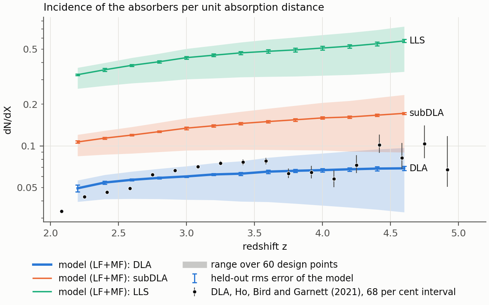
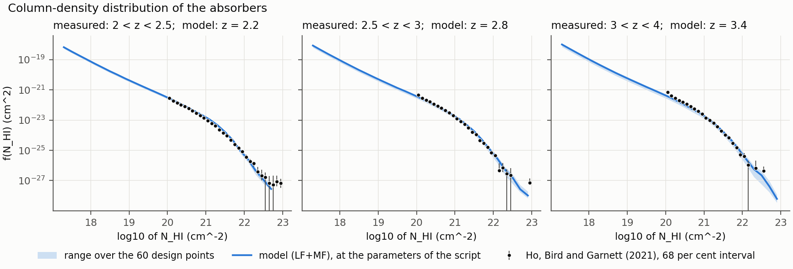
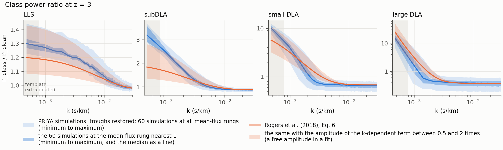

# Figures: the model and the simulations against published work

Three figures, each drawn by one script of `scripts/figures/`. The data files they read are committed under
`docs/figures/data`. The class-ratio figure regenerates from the repository alone. The dN/dX and CDDF figures need a
model that holds an incidence record; their measured points and the 60 design points of their bands are in the
repository.

**What the model figures are drawn from.** No model is published yet. The two model figures below were drawn from the
candidate LF+MF release (staged, not yet public) with the multi-fidelity correction of the incidence built from
five high-resolution simulations. They will be redrawn from the published model.

**The parameters of every model curve,** written out in `scripts/figures/figures_common.py`:

```text
ns = 0.925, Ap = 1.9e-09, herei = 4, heref = 2.7, alphaq = 2.15, hub = 0.7, omegamh2 = 0.143, hireionz = 7.25,
bhfeedback = 0.05, with tau0_amp = 1 and dtau0 = 0
```

These are the midpoint of the range each parameter was trained on. They are not a fiducial cosmology, not a best
fit and not a simulation. Nothing in these figures was fitted to the measurements.

## The incidence dN/dX against Ho, Bird and Garnett (2021)



- **Model (lines):** `pred.dndx` of the LF+MF model at the parameters above, for DLAs (the heavier line), subDLAs
  and LLS, at the snapshots from z = 2.2 to 4.6. The curves end at 4.6, the upper edge of the grouped-validation
  domain of the model's multi-fidelity correction of the P1D (z 2.2 to 4.6; a domain edge, not a statement that a
  validation was passed); below 2.2 the model refuses an LF+MF prediction. The correction of dN/dX that is drawn
  here has its own table, which is not limited to that range, and is not validated at any redshift: the choice of
  4.6 keeps the figure inside the grouped-validation domain of the P1D correction, and says nothing about the
  accuracy of the corrected dN/dX.
- **Model (bands):** the lowest and the highest value over the 60 design points of the low-resolution training
  simulations. They show how far the prediction moves across the training set. They are not an uncertainty. For 12
  of the 60 points the predictor sets a flag that the drawn lines do not have (`outside_sampling_box` for the 12,
  `ns_ridge` for 3 of them); it refuses none, and all 60 are in the bands.
- **The flags of the drawn lines** are in the side file `docs/figures/dndx_vs_ho21.json`. None says that the
  correction rests on one simulation pair, or that its redshift is interpolated or held constant beyond the table.
- **Data (points):** the incidence of DLAs that Ho, Bird and Garnett (2021) measured in SDSS DR16Q, in eighteen
  redshift bins with centres from 2.08 to 4.92, with the 68 per cent interval. The meaning of the table's rows was
  confirmed by the paper's first author on 2026-11-13. The file and its origin:
  `docs/figures/data/ho21/PROVENANCE.md` in the repository. The tables are those of the DLA data collection
  https://github.com/sbird/DLA_data (fetched from its fork https://github.com/jibanCat/DLA_data), read as that
  collection's own reader `ho21_cddf` reads them where it has a reader; the provenance file compares the two step
  by step.
- **Snapshots against bins.** The model is drawn at snapshot redshifts 0.2 apart; the measurement is in bins one
  sixth of a unit wide. The two measured points above z = 4.6 have no model curve beside them, and neither has
  the one below 2.2.
- **Not shown and not tested here.** The held-out error of the model's dN/dX is not shown. Nothing was fitted. The
  measurement covers DLAs only: the subDLA and LLS curves have no measured point in this figure. The simulations and
  the survey define and find absorbers differently; that difference was not assessed.

To regenerate it (the second form when you hold the files of a release):

```text
python scripts/figures/fig_dndx_vs_ho21.py --published
python scripts/figures/fig_dndx_vs_ho21.py --release RELEASE_DIR SHA256
```

## The column-density distribution against Ho, Bird and Garnett (2021)



- **Model (line):** `pred.cddf` against `pred.log_nhi` of the LF+MF model at the parameters above, at the snapshots
  z = 2.2, 2.8 and 3.4. A bin in which the model has no support is NaN and is absent from the line; it is not drawn
  as zero, and the line and the band break there.
- **Model (band):** the lowest and the highest value over the 60 design points of the low-resolution training
  simulations. It shows how far the prediction moves across the training set. It is not an uncertainty. For 12 of
  the 60 points the predictor sets a flag that the drawn line does not have (`outside_sampling_box` for the 12,
  `ns_ridge` for 3 of them); it refuses none, and all 60 are in the band.
- **The flags of the drawn lines** are in the side file `docs/figures/cddf_vs_ho21.json`. None says that the
  correction rests on one simulation pair, or that its redshift is interpolated or held constant beyond the table. At
  z = 2.2 `cddf_bins_without_support` is set: the highest bin has no measured correction there and is absent.
- **Data (points):** the column-density distribution of DLAs that Ho, Bird and Garnett (2021) measured in SDSS
  DR16Q, in their redshift bins 2 to 2.5, 2.5 to 3 and 3 to 4, with the 68 per cent interval. A bar that reaches the
  bottom of a panel has a lower limit of zero. A bin in which the measured f is zero is not drawn, also where the
  table gives an upper limit for it (four bins of the 2.5 to 3 table, six of the 3 to 4 table). For the bin 3 to 4
  the figure takes the table named for that range (`cddf_z34.txt`); the collection's own reader opens the 2.5 to 3
  table for it. The files and their origin:
  `docs/figures/data/ho21/PROVENANCE.md` in the repository. The tables are those of the DLA data collection
  https://github.com/sbird/DLA_data (fetched from its fork https://github.com/jibanCat/DLA_data), read as that
  collection's own reader `ho21_cddf` reads them where it has a reader; the provenance file compares the two step
  by step.
- **One snapshot against one bin.** Each panel sets one snapshot beside a measurement over a range of redshifts. In
  the third panel the model is at the single redshift 3.4 inside a bin one unit wide.
- **The bin 4 to 5 is left out.** It reaches beyond z = 4.6, the upper edge of the grouped-validation domain of the
  model's multi-fidelity correction of the P1D. The correction of the CDDF that is drawn here is not validated at
  any redshift.
- **Not shown and not tested here.** The held-out error of the model's CDDF is not shown. The measurement's tables
  start at log10 N_HI = 20.05; below it the model has no measured point in this figure. The simulations and the
  survey define and find absorbers differently; that difference was not assessed.

To regenerate it (the second form when you hold the files of a release):

```text
python scripts/figures/fig_cddf_vs_ho21.py --published
python scripts/figures/fig_cddf_vs_ho21.py --release RELEASE_DIR SHA256
```

The band is drawn over the 60 design points of `docs/figures/data/priya_lf_design_60.csv`: the design of the PRIYA
suite of Bird et al. (2023) together with the simulations added later in a widened parameter range (the last 12
rows, which are the 12 points the predictor flags `outside_sampling_box`). `--design FILE` takes another table (one header line with the nine parameter names, one row
per point; read without a digest check), and `--no-band` draws the line and the points only.

## The class power ratio of the simulations against Rogers et al. (2018)



- **Simulations (points):** the ratio `P_class / P_clean` at z = 3.0 of the 60 low-resolution PRIYA training
  simulations, with the filtered troughs restored: the mean and the standard deviation over the simulations, for
  k < 0.03 s/km. The ratio is formed in each simulation mode by mode and then averaged; each point is plotted at
  the mean wavenumber of its mode over the simulations (the boxes differ slightly in length in km/s). The file is
  `docs/figures/data/class_ratio_z3p0_lf60.csv`; its header says how it was made.
- **Template (line):** Eq. 6 of Rogers et al. (2018), from the public function
  `hcd_analysis.hcd_template.class_ratio` at z = 3.0, for LLS, subDLA, small DLA and large DLA.
- **The shaded region:** wavenumbers below the lowest mode of the box of Rogers et al., 2 pi / 8000 km/s =
  7.85e-4 s/km (their box at z = 3.01). There the template is evaluated by extrapolation.
- **Two redshifts.** The simulation points are at z = 3.0; the snapshot of Rogers et al. is at z = 3.01.
- **No model in this figure.** The points are simulations, not emulator predictions. The emulator predicts the
  filtered class spectra; its predictions with the troughs restored were not tested, and the public predictor cannot
  produce these points.
- **How to read it,** and what differs between the two sides: [the Rogers comparison page](rogers_comparison.md).

To regenerate it (no model is needed):

```text
python scripts/figures/fig_class_ratio_vs_rogers18.py
```

## References

Ho, M.-F., Bird, S., Garnett, R. 2021, "Damped Lyman-alpha absorbers from Sloan Digital Sky Survey DR16Q with
Gaussian processes", MNRAS, [doi:10.1093/mnras/stab2169](https://doi.org/10.1093/mnras/stab2169),
[arXiv:2103.10964](https://arxiv.org/abs/2103.10964).

Rogers, K. K., Bird, S., Peiris, H. V., Pontzen, A., Font-Ribera, A., Leistedt, B. 2018, "Simulating the effect of
high column density absorbers on the one-dimensional Lyman-alpha forest flux power spectrum", MNRAS, 474 (3),
3032-3042, [doi:10.1093/mnras/stx2942](https://doi.org/10.1093/mnras/stx2942),
[arXiv:1706.08532](https://arxiv.org/abs/1706.08532).
