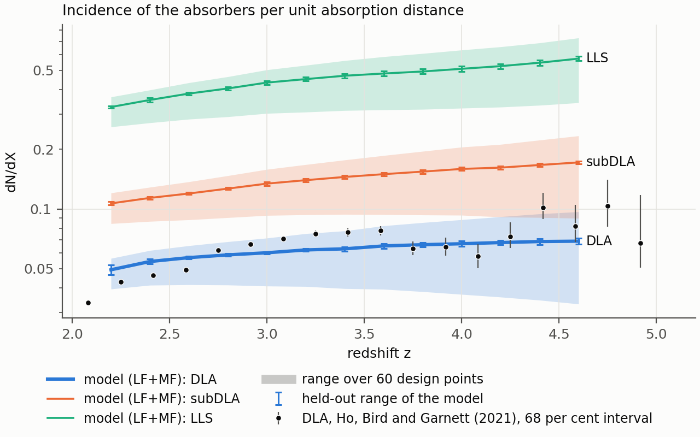
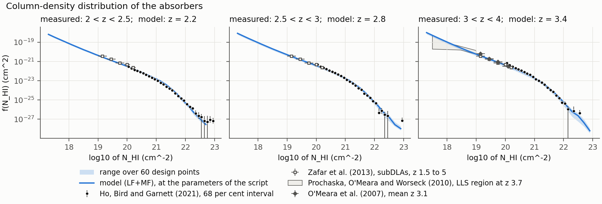
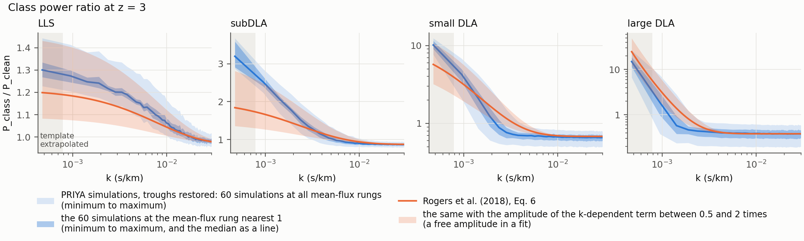
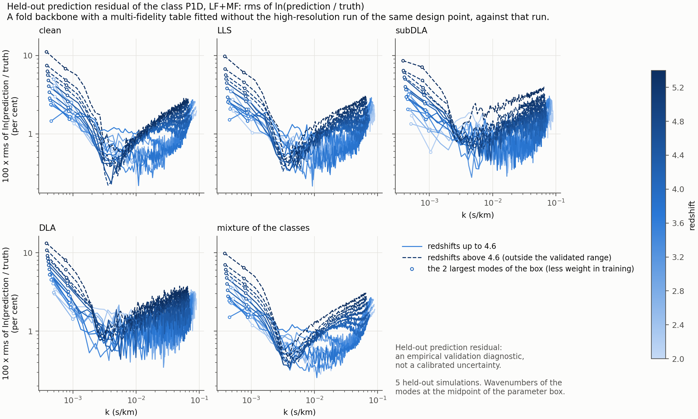

# Figures: the model and the simulations against published work

Three figures against published work, each drawn by one script of `scripts/figures/`, and three figures of the
model's held-out prediction residual of the class P1D, drawn by a fourth script (the last section). The data
files that the first three read are committed under
`docs/figures/data`. The class-ratio figure regenerates from the repository alone. The dN/dX and CDDF figures need a
model that holds an incidence record; their measured points and the 60 design points of their bands are in the
repository. The scripts save their figures to files under the matplotlib backend of your session, which they do not
choose; without a display, set `MPLBACKEND=Agg`.

**What the model figures are drawn from.** No model is published yet. The two model figures below were drawn from the
candidate LF+MF release (staged, not yet public) with the multi-fidelity correction of the incidence built from
five high-resolution simulations. They will be redrawn from the published model.

**The parameters of every model curve,** written out in `scripts/figures/figures_common.py`:

```text
ns = 0.925, Ap = 1.9e-09, herei = 4, heref = 2.7, alphaq = 2.15, hub = 0.7, omegamh2 = 0.143, hireionz = 7.25,
bhfeedback = 0.05, with tau0_amp = 1 and dtau0 = 0
```

These are the midpoint of the range each parameter was trained on. They are not a fiducial cosmology, not a best
fit and not a simulation. Nothing in these figures was fitted to the measurements.

## The incidence dN/dX against Ho, Bird and Garnett (2021) and published LLS incidences



- **Model (lines):** `pred.dndx` of the LF+MF model at the parameters above, for DLAs (the heavier line), subDLAs
  and LLS, at the snapshots from z = 2.2 to 4.6. The classes are bins of column density: LLS 10^17.2 <= N_HI <
  10^19, subDLA 10^19 <= N_HI < 10^20.3, DLA N_HI >= 10^20.3 (in cm^-2). The curves end at 4.6, the upper edge of
  the grouped-validation domain of the model's multi-fidelity correction of the P1D (z 2.2 to 4.6; a domain edge,
  not a statement that a validation was passed); below 2.2 the model refuses an LF+MF prediction. The correction of
  dN/dX that is drawn here has its own table, which is not limited to that range, and is not validated at any
  redshift: the choice of 4.6 keeps the figure inside the grouped-validation domain of the P1D correction, and says
  nothing about the accuracy of the corrected dN/dX.
- **Model (dashed line): every absorber with N_HI >= 10^17.5 cm^-2,** which is what the LLS measurements count
  (below). It is the sum, over the bins of the model's column-density distribution `pred.cddf`, of f(N_HI) times the
  width in N_HI of the bin's part above 10^17.5. The bins are 0.2 wide in log10 N_HI, so 10^17.5 falls inside the
  bin from 10^17.4 to 10^17.6: that bin counts from 10^17.5 to its upper edge with f taken constant within it. This
  partial bin holds 7.2 to 8.4 per cent of the sum; a power law within it, with the slope between its two
  neighbours, would make the sum 1.0 to 1.3 per cent smaller. Two bins of the distribution have no value at z = 2.2:
  the bin from 10^22.8 to 10^23, which has none also at 2.4 and 3.2 (no simulation pair has absorbers there at that
  redshift) and is left out of the sum there, where it has a value it holds less than 1e-5 of the count; and the
  bin from 10^17.0 to 10^17.2, which has none at any redshift (it lies below the catalogue's column-density threshold)
  and lies below 10^17.5 and below the LLS class, so it enters neither the count nor the cross-check. As a
  cross-check the same count formed from the class lines (the LLS line less the distribution's part from 10^17.2 to
  10^17.5, plus the subDLA and the DLA line) agrees with it: their ratio is 0.9998 to 1.0020 over the snapshots (in
  the side file). The partial bin enters both sums in the same way, so the cross-check does not test that choice.
  The band of the dashed line is drawn over the design points like the others.
- **Model (bands):** the lowest and the highest value over the 60 design points of the low-resolution training
  simulations. They show how far the prediction moves across the training set. They are not an uncertainty. For 12
  of the 60 points the predictor sets a flag that the drawn lines do not have (`outside_sampling_box` for the 12,
  `ns_ridge` for 3 of them); it refuses none, and all 60 are in the bands.
- **The flags of the drawn lines** are in the side file `docs/figures/dndx_vs_ho21.json`. None says that the
  correction rests on one simulation pair, or that its redshift is interpolated or held constant beyond the table.
- **Data (points):** the incidence of DLAs that Ho, Bird and Garnett (2021) measured in SDSS DR16Q, in eighteen
  redshift bins with centres from 2.08 to 4.92, with the 68 per cent interval. The meaning of the table's rows was
  confirmed by the paper's first author on 2026-11-13. The file and its origin:
  `docs/figures/data/ho21/PROVENANCE.md` in the repository. The tables are those of the DLA data collection
  https://github.com/sbird/DLA_data (fetched from its fork https://github.com/jibanCat/DLA_data), read as that
  collection's own reader `ho21_cddf` reads them where it has a reader; the provenance file compares the two step
  by step.
- **The points are in the cosmology of the line.** dN/dX is a count per unit absorption distance X, and the
  measurement's X is that of a flat cosmology with Omega_m = 0.279 (the default of the paper's public code; the paper
  does not state it: `docs/figures/data/ho21/PROVENANCE.md`). The line is per unit X of the cosmology of its
  parameters, flat with Omega_m = omegamh2 / hub^2 = 0.143 / 0.70^2 = 0.2918. Each bin's value and its limits are
  multiplied by the same factor, Delta X(0.279) / Delta X(0.2918), with Delta X the integral of
  (1 + z)^2 / sqrt(Omega_m (1 + z)^3 + 1 - Omega_m) over the bin: 1.0202 to 1.0224 (+0.0087 to +0.0096 dex). The
  table stays as published; the factors are in the side file. The bands are not converted: each design point is per
  unit X of its own cosmology (Omega_m from 0.254 to 0.339), so only the lines are in the measurement's cosmology;
  in the cosmology of the bands' two extremes the points would sit 6.0 to 6.6 per cent lower or 6.9 to 7.6 per
  cent higher.
- **Data (LLS points):** the incidence of Lyman limit systems, tau_912 >= 2, which is every absorber with N_HI >=
  10^17.5 cm^-2 counted cumulatively (subDLAs and DLAs included), from five published samples: Prochaska, O'Meara
  and Worseck (2010), journal Table 4, SDSS DR7, six bins from z 3.3 to 4.4; O'Meara et al. (2013), the combined row
  of their Table 5 (their WFC3 and ACS samples with the bin z 1.95 to 2.59 of Ribaudo, Lehner and Howk 2011), z 2.0
  to 2.6; Fumagalli et al. (2013), the non-colour-selected sample, z 2.6 to 3.0; Crighton et al. (2019), the
  corrected values, three bins from z 3.75 to 5.4; Fumagalli, Fotopoulou and Thomson (2020), SDSS DR16, z 3.3 to
  3.6. The last has its own marker (a hollow circle): its absorbers were classified as tau >~ 2, and the paper says
  its catalogue may include some just below tau = 2. The values are copied from the papers' tables and text into
  `docs/figures/data/lls_incidence/lls_lz_literature.dat`, unconverted;
  `docs/figures/data/lls_incidence/PROVENANCE.md` gives each paper, DOI, table and line, and how to rebuild the
  file. The file has six more rows, each contained in a drawn row or counting its absorbers; they are left out, so
  that no drawn row contains another. The drawn samples are not all independent: the SDSS DR16 sample of Fumagalli,
  Fotopoulou and Thomson (2020) shares 344 quasars with the SDSS DR7 sample of Prochaska, O'Meara and Worseck (2010),
  whose bins overlap it in redshift; at z = 3.45 the two points overlap in the figure.
- **The LLS points in the cosmology of the line.** Each paper gives l(z) = dN/dz, which needs no cosmology. The
  figure draws l(X) = l(z) Delta z / Delta X over the row's redshift bin, with Delta X in the cosmology of the line
  (Omega_m = 0.2918); the published 1 sigma errors take the same factor. Each point sits at the centre of its bin,
  with a horizontal bar over the bin. The conversion weights every redshift of a bin equally, where a survey's own
  path weights them unequally (0.03 to 0.22 per cent for the SDSS bins of Prochaska, O'Meara and Worseck 2010; the
  provenance file). In the rows of Prochaska, O'Meara and Worseck (2010) the error printed with the plus sign is the
  smaller one, the reverse of the Poisson interval of a count; the figure swaps the two, the larger error upward. The
  combined O'Meara row is drawn as printed (symmetric, 0.18 either way; its Poisson interval would be 0.16 below and
  0.19 above). The file keeps the print.
- **Snapshots against bins.** The model is drawn at snapshot redshifts 0.2 apart; the measurement is in bins one
  sixth of a unit wide. The two measured points above z = 4.6 have no model curve beside them, and neither has the
  one below 2.2. Of the LLS bins, the one from z 4.7 to 5.4 lies beyond the curves, and the one from 2.0 to 2.6
  starts below them.
- **Model (bars on the lines):** the held-out range of the corrected dN/dX, from `pred.dndx_lower` to
  `pred.dndx_upper`: the two bounds a prediction carries (`pred.dndx * exp(-pred.dndx_err)` and
  `pred.dndx * exp(+pred.dndx_err)`, each computed on its own, so the bars are asymmetric). `pred.dndx_err` is, at
  each snapshot, the rms over five held-out high-resolution simulations of the logarithm of prediction over truth.
  It includes the bias. With five values it is an indication of size, not the standard deviation of a known
  distribution; `labels["incidence_mf_error"]` on a prediction says what it does not cover. It is not the same
  thing as the band, which shows how far the prediction moves across the training set.
- **Not shown and not tested here.** Nothing was fitted. No measurement of the subDLA class alone is drawn. The LLS
  measurements count every absorber above 10^17.5, not the LLS class: read them against the dashed line, not against
  the LLS line. The simulations and the surveys define and find absorbers differently; that difference was not
  assessed.

To regenerate it (the second form when you hold the files of a release):

```text
python scripts/figures/fig_dndx_vs_ho21.py --published
python scripts/figures/fig_dndx_vs_ho21.py --release RELEASE_DIR SHA256
```

## The column-density distribution against Ho, Bird and Garnett (2021)



- **Model (line):** `pred.cddf` against `pred.log_nhi` of the LF+MF model at the parameters above, at the snapshots
  z = 2.2, 2.8 and 3.4. A bin in which the model has no support is NaN and is absent from the line; it is not drawn
  as zero, and the line and the band break there.
- **Model (band):** the lowest and the highest value over the 60 design points of the low-resolution training
  simulations. It shows how far the prediction moves across the training set. It is not an uncertainty. For 12 of
  the 60 points the predictor sets a flag that the drawn line does not have (`outside_sampling_box` for the 12,
  `ns_ridge` for 3 of them); it refuses none, and all 60 are in the band.
- **The flags of the drawn lines** are in the side file `docs/figures/cddf_vs_ho21.json`. None says that the
  correction rests on one simulation pair, or that its redshift is interpolated or held constant beyond the table. At
  z = 2.2 `cddf_bins_without_support` is set: the highest bin, 10^22.8 to 10^23, has no measured correction there
  and is absent. The lowest bin, 10^17.0 to 10^17.2, is absent at every snapshot: it lies below the catalogue's
  column-density threshold, so the model was never trained on it (the side file counts two absent bins at z = 2.2
  and one at 2.8 and 3.4).
- **Data (points):** the column-density distribution of DLAs that Ho, Bird and Garnett (2021) measured in SDSS
  DR16Q, in their redshift bins 2 to 2.5, 2.5 to 3 and 3 to 4, with the 68 per cent interval. A bar that reaches the
  bottom of a panel has a lower limit of zero. A bin in which the measured f is zero is not drawn, also where the
  table gives an upper limit for it (four bins of the 2.5 to 3 table, six of the 3 to 4 table). For the bin 3 to 4
  the figure takes the table named for that range (`cddf_z34.txt`); the collection's own reader opens the 2.5 to 3
  table for it. The files and their origin:
  `docs/figures/data/ho21/PROVENANCE.md` in the repository. The tables are those of the DLA data collection
  https://github.com/sbird/DLA_data (fetched from its fork https://github.com/jibanCat/DLA_data), read as that
  collection's own reader `ho21_cddf` reads them where it has a reader; the provenance file compares the two step
  by step.
- **Data below the DLA threshold:** in every panel, the f(N_HI) of subDLAs that Zafar et al. (2013) measured over
  z 1.51 to 5.00 (open squares); in the panel 3 < z < 4, the f(N_HI) of O'Meara et al. (2007) for log10 N_HI 19.0 to
  20.3 at a mean z of 3.1 (filled diamonds), and the region of f(N_HI) that Prochaska, O'Meara and Worseck (2010)
  allow for LLS at z 3.7 (the shaded region). The subDLA table is a file of the same collection, read as its own
  reader reads it; the other two are built from the papers' own tables (O'Meara et al., Table 5, sample ALL-19.0;
  Prochaska, O'Meara and Worseck, the conservative range of their f(N) table), in the formats of the collection's
  readers. `docs/figures/data/lls_subdla/PROVENANCE.md` in the repository gives the sources line by line and
  compares the readers step by step. Their redshifts are not the model's snapshots, and Zafar et al. cover a wider
  range than any panel.
- **Every measurement is in the cosmology of the line.** f(N_HI, X) is a count per unit X. Ho, Bird and Garnett
  computed their X in a flat cosmology with Omega_m = 0.279 (the default of their public code), the other three in
  one with Omega_m = 0.3 (stated in each paper). The line is per unit X of the cosmology of its parameters, flat with
  Omega_m = 0.2918. Each measurement's values and limits are multiplied by the same factor, Delta X(own) /
  Delta X(0.2918) over its redshift range (each panel's bin for Ho, Bird and Garnett; the paper's sample for the
  others): 1.0205, 1.0213 and 1.0219 (+0.0088 to +0.0094 dex) for the three DLA tables; 0.9870, 0.9871 and 0.9867
  (-0.0057 to -0.0058 dex) for Zafar et al., O'Meara et al. and Prochaska, O'Meara and Worseck. The files stay as
  published; the factors are in the side file, and the two PROVENANCE.md files give each cosmology and redshift
  range with its source. The band is not converted (each design point is per unit X of its own cosmology, Omega_m
  from 0.254 to 0.339): only the line is in the measurements' cosmology.
- **One snapshot against one bin.** Each panel sets one snapshot beside a measurement over a range of redshifts. In
  the third panel the model is at the single redshift 3.4 inside a bin one unit wide.
- **The bin 4 to 5 is left out.** It reaches beyond z = 4.6, the upper edge of the grouped-validation domain of the
  model's multi-fidelity correction of the P1D. The correction of the CDDF that is drawn here is not validated at
  any redshift.
- **Not shown and not tested here.** The held-out error of the model's CDDF is not drawn in this figure (with 29
  bins and five held-out simulations per bin it would hide the comparison); a prediction carries its range per bin as
  `pred.cddf_lower` and `pred.cddf_upper`. The measurement's tables
  start at log10 N_HI = 20.05; below it the points are the three measurements above, at other redshifts. The simulations and the
  survey define and find absorbers differently; that difference was not assessed.

To regenerate it (the second form when you hold the files of a release):

```text
python scripts/figures/fig_cddf_vs_ho21.py --published
python scripts/figures/fig_cddf_vs_ho21.py --release RELEASE_DIR SHA256
```

The band is drawn over the 60 design points of `docs/figures/data/priya_lf_design_60.csv`, which are those of the emulator files of Fernandez, Bird and Ho (2024): 48 are the design of Bird et al. (2023) and 12 were added by Fernandez et al., whose paper states "a total of 60 low fidelity (LF) and 3 high fidelity (HF) simulations" (the
last 12 rows of the table, which are the 12 points the predictor flags `outside_sampling_box`). `--design FILE` takes another table (one header line with the nine parameter names, one row
per point; read without a digest check), and `--no-band` draws the line and the points only.

## The class power ratio of the simulations against Rogers et al. (2018)



- **Simulations (blue):** the ratio `P_class / P_clean` at z = 3.0 of the low-resolution PRIYA training
  simulations with the filtered troughs restored, for k < 0.03 s/km. The lighter band is the range, minimum to
  maximum, over the 60 simulations at all 20 mean-flux rungs; the darker band is the range over the 60 simulations
  at the mean-flux rung nearest 1; the line is the median of that set. The 60 simulations differ in the nine
  cosmological and astrophysical parameters, so the bands show how the ratio varies with them and with the mean
  flux. The ratio is formed in each simulation mode by mode; each mode is plotted at its mean wavenumber over the
  simulations (the boxes differ slightly in length in km/s). The file is
  `docs/figures/data/class_ratio_ranges_z3p0_lf60.csv`; its header says how it was made.
- **Template (orange line):** Eq. 6 of Rogers et al. (2018) as published, from the public function
  `hcd_analysis.hcd_template.class_ratio` at z = 3.0, for LLS, subDLA, small DLA and large DLA.
- **Template (orange band):** c(z) + alpha x T(k, z) for alpha between 0.5 and 2, where T is the k-dependent term
  of Eq. 6 and c its constant. In a fit Rogers et al. leave the amplitudes free and let a free normalisation absorb
  c(z). The range 0.5 to 2 is this figure's choice, to show what a free amplitude does; it is not a prior from the
  paper. An overlap of the two colours says that some amplitude in that range and some simulation agree at that k,
  and no more.
- **The shaded region:** wavenumbers below the lowest mode of the box of Rogers et al., 2 pi / 8000 km/s =
  7.85e-4 s/km (their box at z = 3.01). There the template is evaluated by extrapolation.
- **Two redshifts.** The simulations are at z = 3.0; the snapshot of Rogers et al. is at z = 3.01.
- **No model in this figure.** The bands are simulations, not emulator predictions. The emulator predicts the
  filtered class spectra; its predictions with the troughs restored were not tested, and the public predictor cannot
  produce these ratios.
- **How to read it,** and what differs between the two sides: [the Rogers comparison page](rogers_comparison.md).

To regenerate it (no model is needed):

```text
python scripts/figures/fig_class_ratio_vs_rogers18.py
```

## The held-out prediction residual of the class P1D

These figures show what `P_class_validation_rms_log` and `P_mix_validation_rms_log` of a prediction hold. They are
drawn from the model's own P1D held-out record (`docs/release_format_h5.md`, section "The P1D held-out record"), by
one script. They show an empirical validation diagnostic, not a calibrated uncertainty: for simulations the model
was made without, how far the predicted spectrum lies from the simulation. Like the two model figures above, they
were drawn from the candidate LF+MF release and will be redrawn from the published model.




- **What is drawn.** e = the rms of ln(prediction / truth) over the held-out simulations and the 20 mean-flux
  rungs, as 100 e in per cent, for each class and for the mixture (the class spectra mixed with each held-out
  simulation's own class fractions), one line per snapshot redshift. The colour, light to dark, is the redshift.
  LF: a fold model against the low-fidelity simulation it was trained without, six simulations. LF+MF: a fold model
  with a multi-fidelity table fitted without the high-resolution run of the same design point, against that run,
  five simulations.
- **Three cases, kept apart.** Solid lines beyond the open markers: redshifts 2.2 to 4.6 above the two largest
  modes of the box, the typical case. Open markers: the two largest modes, which training gave less weight; the
  residual is larger there. Dashed lines: redshifts above 4.6, outside the validated range.
- **The darkest dashed line of the LF figure, z = 5.4,** is dominated by one held-out simulation whose source
  spectra file is incomplete at that redshift (a listed limitation of the release: `docs/models_and_data.md`). The
  dotted line is the same table without that simulation.
- **Not an error bar.** The numbers rest on five or six simulations that share their initial phases with the
  training simulations, and a substantial part of the residual is present for simulations the model was trained
  on. The likelihood does not use them.
- **Wavenumbers.** The modes of the box, converted to s/km at each redshift with `hub` and `omegamh2` of the
  midpoint above. Each simulation has its own cosmology, so its own wavenumbers differ from these by a few per cent.
- **The side files** (`p1d_validation_lf.json`, `p1d_validation_lfmf.json`) hold, per row, the median and the
  largest value in each of these cases, and the record the figure was drawn from.


- **What is drawn.** The residual itself, d = ln(prediction / truth) of the mixture, with its sign, as 100 d in per
  cent, one line per held-out simulation, at the mean-flux rung nearest the mean flux of Kim et al. (2007). These
  are the vectors of the record's evidence file, which ships with the model. The vertical axis is linear within 5
  per cent and logarithmic beyond.
- **Two simulations are drawn in a colour.** Orange, `ns0.914Ap1.32e-09`: the prediction lies above the simulation
  at the largest scales, more so at higher redshift. Blue, `ns0.979Ap1.78e-09`: at z = 5.4 its LF line leaves the
  others by far; this is the simulation with the incomplete source file, and the one the dotted line above leaves
  out. The other simulations are grey.
- **For one class** in place of the mixture, add `--row clean`, `--row LLS`, `--row subDLA` or `--row DLA`; the
  figure is then written as `p1d_validation_by_simulation_<row>.png`. Only the figure of the mixture is committed.

To regenerate the three figures:

```text
python scripts/figures/fig_p1d_validation.py --published
python scripts/figures/fig_p1d_validation.py --release RELEASE_DIR SHA256
```

**The same on a prediction of your own.** With `pred` from `emu.predict(...)` of a model that carries the record
(the flag `p1d_validation_available` is set), this draws one class spectrum with the range
`P_class_validation_lower` to `P_class_validation_upper` around it. The band is the validation diagnostic above,
not a calibrated uncertainty:

```python
import matplotlib.pyplot as plt

c = 3  # the class, in the order of hp.CLASSES: 0 clean, 1 LLS, 2 subDLA, 3 DLA
fig, ax = plt.subplots()
ax.loglog(pred.k, pred.P_class[c], label="prediction")
ax.fill_between(pred.k, pred.P_class_validation_lower[c], pred.P_class_validation_upper[c], alpha=0.3,
                label="held-out prediction residual (a validation diagnostic)")
ax.set(xlabel="k (s/km)", ylabel="P1D (km/s)"); ax.legend(); fig.savefig("my_prediction.png")
```

The record itself, with its tables per fidelity and its texts, is `hp.p1d_heldout_record(emu)`
(`import hcd_analysis.predictor as hp`).

## References

The measurements drawn, each with the provenance file of its data in `docs/figures/data/`:

Crighton, N. H. M., Prochaska, J. X., Murphy, M. T., O'Meara, J. M., Worseck, G. 2019, "Imprints of the first billion
years: Lyman limit systems at z ~ 5", MNRAS 482, 1456,
[doi:10.1093/mnras/sty2762](https://doi.org/10.1093/mnras/sty2762),
[arXiv:1810.10040](https://arxiv.org/abs/1810.10040).

Fumagalli, M., O'Meara, J. M., Prochaska, J. X., Worseck, G. 2013, "Dissecting the properties of optically-thick
hydrogen at the peak of cosmic star formation history", ApJ 775, 78,
[doi:10.1088/0004-637X/775/1/78](https://doi.org/10.1088/0004-637X/775/1/78),
[arXiv:1308.1101](https://arxiv.org/abs/1308.1101).

Fumagalli, M., Fotopoulou, S., Thomson, L. 2020, "Detecting neutral hydrogen at z >~ 3 in large spectroscopic surveys
of quasars", MNRAS 498, 1951, [doi:10.1093/mnras/staa2388](https://doi.org/10.1093/mnras/staa2388),
[arXiv:2009.03322](https://arxiv.org/abs/2009.03322).

Ho, M.-F., Bird, S., Garnett, R. 2021, "Damped Lyman-alpha absorbers from Sloan Digital Sky Survey DR16Q with
Gaussian processes", MNRAS 507, 704, [doi:10.1093/mnras/stab2169](https://doi.org/10.1093/mnras/stab2169),
[arXiv:2103.10964](https://arxiv.org/abs/2103.10964).

O'Meara, J. M., Prochaska, J. X., Burles, S., Prochter, G., Bernstein, R. A., Burgess, K. M. 2007, "The Keck +
Magellan Survey for Lyman Limit Absorption. I. The Frequency Distribution of Super Lyman Limit Systems", ApJ 656,
666, [doi:10.1086/510711](https://doi.org/10.1086/510711),
[arXiv:astro-ph/0610726](https://arxiv.org/abs/astro-ph/0610726).

O'Meara, J. M., Prochaska, J. X., Worseck, G., Chen, H.-W., Madau, P. 2013, "The HST/ACS+WFC3 Survey for Lyman Limit
Systems. II. Science", ApJ 765, 137,
[doi:10.1088/0004-637X/765/2/137](https://doi.org/10.1088/0004-637X/765/2/137),
[arXiv:1204.3093](https://arxiv.org/abs/1204.3093).

Prochaska, J. X., O'Meara, J. M., Worseck, G. 2010, "A Definitive Survey for Lyman Limit Systems at z ~ 3.5 with the
Sloan Digital Sky Survey", ApJ 718, 392,
[doi:10.1088/0004-637X/718/1/392](https://doi.org/10.1088/0004-637X/718/1/392),
[arXiv:0912.0292](https://arxiv.org/abs/0912.0292).

Ribaudo, J., Lehner, N., Howk, J. C. 2011, "A Hubble Space Telescope Study of Lyman Limit Systems: Census and
Evolution", ApJ 736, 42, [doi:10.1088/0004-637X/736/1/42](https://doi.org/10.1088/0004-637X/736/1/42),
[arXiv:1105.0659](https://arxiv.org/abs/1105.0659).

Zafar, T., Peroux, C., Popping, A., et al. 2013, "The ESO UVES advanced data products quasar sample. II. Cosmological
evolution of the neutral gas mass density", A&A 556, A141,
[doi:10.1051/0004-6361/201321154](https://doi.org/10.1051/0004-6361/201321154),
[arXiv:1307.0602](https://arxiv.org/abs/1307.0602).

The simulations and the template:

Fernandez, M. A., Bird, S., Ho, M.-F. 2024, "Cosmological constraints from the eBOSS Lyman-alpha forest using the
PRIYA simulations", JCAP 2024 (07) 029,
[doi:10.1088/1475-7516/2024/07/029](https://doi.org/10.1088/1475-7516/2024/07/029),
[arXiv:2309.03943](https://arxiv.org/abs/2309.03943).

Rogers, K. K., Bird, S., Peiris, H. V., Pontzen, A., Font-Ribera, A., Leistedt, B. 2018, "Simulating the effect of
high column density absorbers on the one-dimensional Lyman-alpha forest flux power spectrum", MNRAS, 474 (3),
3032-3042, [doi:10.1093/mnras/stx2942](https://doi.org/10.1093/mnras/stx2942),
[arXiv:1706.08532](https://arxiv.org/abs/1706.08532).
