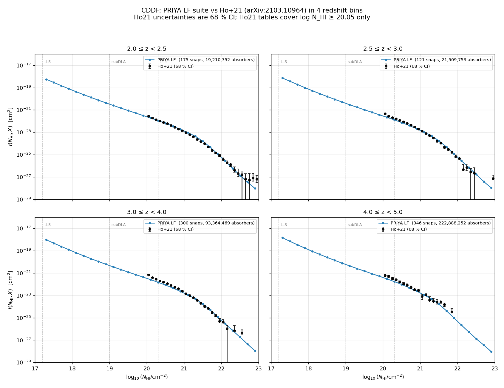

# The research pipeline: catalogue construction and the four stages

This page was part of the [README](../README.md) until 2026-11 and is kept word for word. It describes the research
pipeline that the emulator was built for. The supported interface of this release is the predictor
([README](../README.md#scope-and-limitations-of-this-release)).

Throughout this page, each stage is marked with what it needs:
**requires the full data / Great Lakes (not in this repo)** for anything that
builds the catalogs, the full cache, or trains the emulator;
**needs the release files** for the public predictor; and **research code** for
the likelihood and the fits, which do not run from this repository at this commit.

## HCD catalog construction

**Requires the full data / Great Lakes (not in this repo).** This step reads the
raw PRIYA τ skewers, which are large and not distributed here; it is a cluster
job. The structure of the products it describes can still be read for reference.

The HCD catalog is the foundation the rest of the pipeline rests on: it records,
for every PRIYA simulation and redshift, which sightlines intersect a dense
absorber and how much neutral hydrogen that absorber carries. From the catalog we
derive the column-density distribution function and the per-class P1D, and those
products are what the emulator is ultimately trained on.

The catalog is built directly from the optical-depth (τ) skewers produced by
`fake_spectra`. For each sightline, `hcd_analysis/catalog.py` locates connected
velocity regions where τ exceeds a detection threshold, merges regions separated
by less than a velocity gap, and estimates the column density N_HI of each system.
In production the column density is obtained by the sum-rule inversion (the fast
estimator, `absorber.fast_mode: true` in the config); a full Voigt fit with a
±2000 km/s wing window is available as an alternative. Each system is then placed
into one of three classes by its N_HI, with everything below the LLS threshold
discarded as forest:

- LLS:    10^17.2 ≤ N_HI < 10^19.0 cm⁻²
- subDLA: 10^19.0 ≤ N_HI < 10^20.3 cm⁻²
- DLA:    N_HI ≥ 10^20.3 cm⁻²

These boundaries are defined in `hcd_analysis/catalog.py` (`classify_system`), and
the detection and measurement parameters (τ threshold, merge gap, the N_HI floor)
live under `absorber:` in `config/default.yaml`.

Build the catalog as part of the per-simulation pipeline (`hcd_env`):

```bash
hcd run-sim --sim ns0.803Ap2.2e-09 --config config/default.yaml   # one sim, all snaps
hcd run-all --n-workers 36 --config config/default.yaml             # full 60-sim LF campaign
```

Each output root holds the results of one set of settings: the first run writes `run_settings.json` there, and a
later run with different settings, or into a root that holds files but no record, is refused before anything is
written (`hcd_analysis/run_settings.py`).

On Great Lakes the full campaign runs as a SLURM array, one task per simulation:

```bash
sbatch --array=0-59 scripts/batch_greatlakes.sh run-one-array
```

The input is the τ skewer HDF5 for each (sim, snap), read alongside the
`SimulationICs.json` that records the simulation's cosmology. The output is one
`catalog.npz` per (sim, snap) under `outputs/{sim}/snap_{NNN}/`, holding, for
every detected absorber, its sightline index, pixel range, N_HI, Doppler
parameter and class. The same run also writes the per-class P1D (`p1d.npz`) and
the per-snapshot CDDF (`cddf.npz`), which `cddf.py` stacks per redshift bin into
`cddf_stacked.npz`. Those per-class P1D and CDDF products, resampled across the
mean-flux ladder, are what `scripts/build_emulator_cache_tau0.py` assembles into
the τ₀ training cache described in Stage 1.

---

## The pipeline, stage by stage

> **A historical record, not a validation of a released model.** The stages, figures and numbers below describe the
> analysis campaign carried out with the historical emulator, which was trained on absorber catalogues made before the
> box-edge duplicate fix ([`docs/bugs_found.md`](bugs_found.md), bug 8). They are kept as a record of that work.
> A released model will come with its own validation.

The pipeline has four stages, described in order. Each stage notes the product it
yields, shows the figure it produces, and gives the command that generated or
exercises it. `<emu-env>` below stands for `JAX_PLATFORMS=cpu python`, run from the
repository root in the installed environment ([Install](../README.md#install)).

### Stage 1 — the simulation P1D, absorber catalog and τ₀ cache

**Requires the full data / Great Lakes (not in this repo).** This stage reads the
raw PRIYA spectra and builds the 1.1 GB τ₀ cache; neither the inputs nor the
assembled cache is distributed here (both are gitignored).

The first stage turns raw PRIYA spectra into the products everything downstream
depends on: the per-sightline P1D, the absorber catalog (which sightlines
intersect an LLS, subDLA or DLA, as described in the section above), the
column-density distribution function CDDF = f(N_HI, X), and the per-class P1D
split between the clean forest and each HCD class. We resample these measurements
across a ladder of mean-flux rescalings to form the τ₀ cache that trains the
emulator. Here τ₀ is the mean-flux optical depth, τ₀ = −ln⟨F⟩; scanning it on a
ladder lets the emulator learn the mean-flux dependence directly.

This stage yields an absorber catalog, the per-class P1D and a CDDF for each
(sim, z), along with the assembled τ₀ training cache. The figure below compares
PRIYA's CDDF with the Ho et al. 2021 observations, a check that the simulated HCD
population is realistic.



Run it (catalog/P1D side, `hcd_env`):

```bash
hcd run-sim --sim ns0.803Ap2.2e-09 --config config/default.yaml   # one sim, all snaps
hcd run-all --n-workers 36 --config config/default.yaml             # full campaign
```

Build the τ₀ cache for the emulator:

```bash
<emu-env> scripts/build_emulator_cache_tau0.py     # -> hcd_analysis/_emulator_data/observables_tau0_lf.h5
```

### Stage 2 — the HCD-marginalised emulator

**Training requires the full data / Great Lakes (not in this repo)** — the LOSO
sweep needs the full τ₀ cache. **Using a released model needs only the release
files** (the [Quickstart](../README.md#quickstart) of the README). The emulator README's low-level
forward-model API needs a current-format checkpoint and a slice of the training
cache, neither of which is public.

A differentiable JAX/Equinox network learns the per-class P1D as a smooth
function of the cosmology θ, the redshift z and τ₀. The central design choice is
that the HCD contamination enters as a free per-class amplitude on top of the
clean forest, so that the inference can marginalise over the HCD incidence rather
than assuming the simulation reproduced it exactly. Before 2026-10 the emulator was
checked with leave-one-simulation-out (LOSO) cross-validation: for each fold it was
trained on all simulations but one and tested on the held-out simulation, which is
how its own error budget was estimated. The release validation is reported separately.

This stage yields a fast, autodifferentiable forward model
`P_obs(θ, z, τ₀, α_HCD)`. Its held-out error is measured per fold as a Fisher
bias: the emulator residual projected onto the directions the data actually
constrain (the Fisher-information eigendirections) and read off as a cosmology
shift in units of σ along those directions; this is the cosmology-relevant bias
rather than a raw spectral error. The results are reported with the release
validation, which is not public yet.

Train it (the 8-fold LOSO sweep; `--smoke` for a fast shape check):

```bash
<emu-env> scripts/run_loso_sweep.py --out checkpoints/final --histdir checkpoints
```

The emulator has its own detailed README, covering the architecture, the τ₀
ladder, the forward model, the conventions and the input contract. It is the
reference for anything emulator-specific:
[`hcd_analysis/emulator/README.md`](../hcd_analysis/emulator/README.md).

### Stage 3 — the differentiable likelihood

**Research code; not runnable from this repository at this commit.** The likelihood
is a Python/JAX API on top of the emulator. Its inputs (training checkpoints, the
training cache and the emulator-error products) are not distributed, and no script
here evaluates it on a data leg. What runs is the likelihood on synthetic inputs,
in the test suite.

The emulator's `P_obs` is wired into a Gaussian log-likelihood that compares the
prediction to the data (the DESI DR1 and KODIAQ-SQUAD P1D) through an
emulator-error covariance and physically motivated priors. The HCD incidence
prior is centred on the observed dN/dX rather than the simulation's; it was
designed so that an incorrect prior centre should not propagate into the
cosmology, which is a check of that research path (below).

As research code, this stage yields a fully differentiable log-posterior suitable
for a gradient sampler, together with the HCD-incidence prior; neither is part of
the supported interface of this release. Whether a mis-centred incidence
prior shifts the cosmology is a check of that research path, not of this release.

The likelihood is a Python API rather than a one-shot script. The snippet below
shows the import only; it does not produce output on its own, and the full call
signature is given in the emulator README §8 and §5:

```python
from hcd_analysis.emulator.inference import log_lik_multiz, hcd_incidence_prior
# illustrative import only — full call signature in the emulator README §8 / §5
```

### Stage 4 — inference and closure

**Research code; no inference driver runs at this commit.** The fit and closure
scripts in `scripts/` call interfaces that the 2026 k-grid fix retired
([`tests/DEFERRED.md`](../tests/DEFERRED.md)); rebuilding them is follow-up work. The
paragraphs below describe the method and the runs made before 2026-10.

The final stage samples the posterior with NUTS, the No-U-Turn Sampler, a
gradient-based MCMC method that exploits the differentiable likelihood. Before
2026-10 the pipeline was checked with closure tests: mock data drawn from a known
truth were fitted to confirm that it is recovered within the stated error bars. Closure on
mocks and on public archival data (eBOSS DR14, KODIAQ-SQUAD) may be committed;
any DESI cosmology result stays local and blinded.

This stage is designed to yield posterior constraints on (A_p, n_s) and a closure
verdict: how many of the held-out mocks recover the truth within ±1σ, and whether
the sampler diverges. It does not run at this commit, and no fit or closure result
is part of this release.

What these closures do and do not certify is worth stating plainly. Before 2026-10
they checked the architecture, that is the forward model, the covariance and the
sampler, that the production all-sims N=5 ensemble inherits. The ensemble-level production SBC
(rank-based simulation-based calibration on the production ensemble itself) is the
final inference-calibration gate of that research path; neither it nor a fit to
real data is part of this release.

The SBC / closure machinery (PIT-ECDF bands, coverage, whitening tests) lives in
`hcd_analysis/emulator/closure_diagnostics.py`; the validation writeups of that
research path are not public and are not part of this release.
