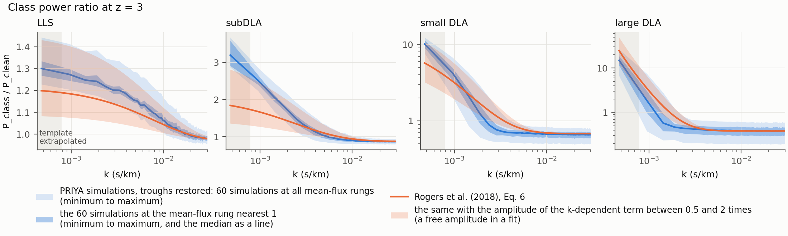

# The class spectra against the model of Rogers et al. (2018)

The predictor returns the P1D of four classes of sightlines: clean, LLS, subDLA and DLA. A similar decomposition, by
the strongest absorber of each sightline, was used by Rogers et al. (2018) with five classes: forest, LLS, sub-DLA,
small DLA and large DLA. Their forest class is the clean class here, and their two DLA classes together are the DLA
class here. They fitted a model of each class's P1D relative to the forest class on the Illustris-1 simulation. This
page records one comparison of the PRIYA simulations behind hcd_priya with that model.

**In one sentence:** with the filtered troughs restored, the median over k < 0.03 s/km of the relative difference
between the per-class ratios of the PRIYA simulations and the per-class model of Rogers et al. (2018, their Eq. 6) is
0.4% to 1.3% for LLS, 0.6% to 2.2% for subDLA, and 1.0% to 3.3% or 2.8% to 8.9% for DLA, for the two ways of mixing
the two DLA templates (each a range over the redshifts 2.6 to 4.2; the table below); the amplitudes at the lowest
wavenumbers differ. These numbers cannot be recomputed from the public package: they need the per-class spectra of
the training simulations with and without the filter, which are not distributed.

## What was compared

- **Simulations only.** No survey data enters, and no emulator prediction.
- **The simulation side.** The ratio `R = P_class / P_clean` from the 60 low-resolution training simulations, taken
  on the mean over the simulations, at the mean-flux rung nearest a tau0 amplitude of 1, at redshifts 2.6 to 4.2 and
  wavenumbers k < 0.03 s/km.
- **With the filtered troughs restored.** The class spectra that the predictor returns are PRIYA-filtered with
  the DLA mask of Bird et al. (2023, their Section 2.7): on a sightline whose largest pixel optical depth exceeds
  1e6, the region around that maximum where tau > 0.25 + tau_eff is set to tau_eff (also
  `docs/masking_strategy.md`). That removes the cores of the strongest absorbers, and the predictor
  states it as its two omissions (`pred.labels["omissions"]`): the power of the subDLA cores and the DLA
  damping-wing core are not added back. For this comparison both were added back.
- **The model side.** The per-class ratio of Rogers et al. (2018), their Eq. 6, including its constant c(z), as coded
  in `hcd_analysis.hcd_template.class_ratio`:

  ```text
  P_class / P_forest (k, z) = f_z(z) * (a(z) * exp(b(z) * k) - 1)**-2 + c(z)
  ```

- **The DLA class.** Rogers et al. split the DLAs into small and large. The simulations here have one DLA class, so
  it is compared with a mix of the two templates, once with the shares of Rogers et al. (0.585 and 0.415: 5.5% and
  3.9% of their spectra at z = 3.01, their Table 1) and once with the simulations' own shares.

## The simulation of Rogers et al.

Rogers et al. (2018, their Section 3.1) use Illustris-1, "the highest-resolution ... cosmological hydrodynamical
simulation from the Illustris project" (Vogelsberger et al. 2014a, 2014b; Nelson et al. 2015), run with the
moving-mesh code AREPO (Springel 2010).

- **Box and cosmology:** a periodic box of (106.5 Mpc)^3 comoving, with Omega_m = 0.2726, Omega_Lambda = 0.7274,
  Omega_b = 0.0456, sigma_8 = 0.809, n_s = 0.963 and h = 0.704. Rogers et al. give no particle number; Vogelsberger
  et al. (2014a) give 2 x 1820^3 resolution elements for Illustris-1. PRIYA's boxes are 120 Mpc/h (Bird et al.
  2023).
- **Snapshots:** z = 2.00, 2.44, 3.01, 3.49 and 4.43.
- **Spectra:** 562,500 sightlines per snapshot on a square grid, each the full length of the box (7111, 7501, 8000,
  8420 and 9199 km/s at those redshifts), with the optical depth in 25 km/s bins smoothed with a Gaussian of 8 km/s
  FWHM.
- **Section, equation and table numbers** on this page are those of the arXiv versions (arXiv:1706.08532 and
  arXiv:2306.05471); the numbering of the journal versions was not checked.

## The numbers

The median over k of `|Rogers / R - 1|`, as a range over the redshifts. `s` is the amplitude of the k-dependent term
that fits the simulations best, where 1 is the amplitude of Rogers et al.

| Class | Against Eq. 6, `c(z) + T` | Against `1 + T` | `s`, troughs restored | `s`, filtered |
|---|---|---|---|---|
| LLS (restoring the troughs changes nothing) | 0.4% to 1.3% | 3.0% to 3.6% | 1.25 to 1.54 | the same |
| subDLA | 0.6% to 2.2% | 13% to 16% | 1.5 to 1.9 (1.36 to 1.67 without the lowest mode) | 0.58 to 0.61 |
| DLA, the shares of Rogers et al. | 2.8% to 8.9% | 54% to 75% | 0.70 to 0.99 (0.95 to 1.03 without the lowest mode) | 0.02 to 0.09 |
| DLA, the simulations' own shares | 1.0% to 3.3% | 54% to 75% | 0.86 to 1.17 (0.94 to 1.03 without the lowest mode) | 0.02 to 0.11 |

Three things to read with the table:

- **The constant matters.** Rogers et al. fit Eq. 6, `c(z) + T`, to each class of their simulation. Their Eq. 8 is
  their model for use in inference, with free amplitudes alpha_0 and alpha_i; `1 + T` is that model for one class
  with the amplitudes set to 1. It is not their prediction for one class: that is Eq. 6. The constant c is 0.95 to 0.97 for
  LLS, 0.87 for subDLA, 0.67 to 0.70 for small DLAs and 0.36 to 0.43 for large DLAs, so comparing a class ratio with
  `1 + T` is off by 13% to 75% for the subDLA and DLA classes.
- **What Rogers et al. say about the constant and the amplitudes** (their Section 6). The constant depends on the
  length of the spectra: "a longer spectrum will have a larger fraction that is uncontaminated, causing the constant
  value at high k_parallel to rise with spectrum length. However, in an analysis of observational data this will be
  absorbed into a free parameter." And in a fit the amplitudes are free: "it will be necessary to vary five free
  parameters alpha_0 and alpha_i", where "the parameter alpha_0 is degenerate with factors that rescale the mean
  flux and could be omitted in an end-to-end analysis". The PRIYA sightlines are longer than theirs, and the medians
  of the table are set by the plateau, so the agreement of the medians rests on a constant that Rogers et al. tie to
  their own sightline length and expect a fit to absorb. The comparison on this page uses no free amplitude.
- **The median hides the troughs.** Against Eq. 6 the filtered spectra also give small medians (subDLA 0.3% to 4%,
  DLA 2% to 8%). The median is set by the plateau above k of about 0.005 s/km, where the troughs add 0.4% to 8%.
  Restoring them matters at the lowest modes: at z = 3 the DLA ratio at the lowest mode is 0.84 filtered and 11.6
  restored. The filter removes the low-k rise of the subDLA and DLA classes, which is what the column `s` shows.
- **What does not agree at that level: the low-k amplitude.** The LLS and subDLA classes of PRIYA rise more steeply
  towards low k than the template (`s` of 1.3 to 1.9); the large-DLA class rises less (`s` of 0.47 to 0.89). The
  cause is not established. Two things are known about the two sides at low k:
  - **The template.** It was fitted on a smaller box than PRIYA's. Below roughly the lowest modes of that box it is an
    extrapolation and is not reliable there. This is an order-of-magnitude argument from the box size, not a
    measurement of the template's error.
  - **The simulations.** Bird et al. (2023) estimate the cosmic variance of the PRIYA flux power spectrum from two
    simulations that differ only in their initial seed (their section 3.1 and Figure 5): about 2 per cent at z < 3.6,
    and 2 to 5 per cent for k < 3e-3 s/km at z >= 4. Those numbers are for the total flux power, not for the class
    ratios compared here, whose own variance was not measured.

## The comparison at z = 3, drawn



Points: the simulations with the troughs restored, the mean and the standard deviation over the 60 simulations, at
z = 3.0. For this figure the DLA sightlines of the simulations are split into small and large at log10 N_HI = 21, as
in Rogers et al.; the table above compares one DLA class with a mix of the two templates. Line: Eq. 6 of Rogers et
al. (2018) from `hcd_template.class_ratio`, evaluated at z = 3.0; their snapshot is at z = 3.01. Shaded: below 2 pi / 8000 km/s = 7.85e-4 s/km, the
lowest mode of their box, where the template is evaluated by extrapolation. The figure holds no emulator prediction.
Its script and data: [the figures page](model_figures.md).

## What "restoring the troughs" means

- The restored term is the unfiltered class power minus the filtered class power, at the same optical-depth scaling
  and with one global mean flux.
- It is exactly zero for the clean class, and exactly zero for the LLS class at redshifts 2.6 to 4.2. It is
  non-zero for the subDLA and DLA classes in every case.
- The filter removes the core of an absorber and the part of its wings above the fill threshold; the restored term
  brings back both.
- The historical forward model of this repository adds back the DLA term only and leaves the subDLA class
  filtered. This comparison restores both.

## The template as coded

- `hcd_analysis/hcd_template.py` holds the coefficients a0, a1, b0, b1, c0, c1, the pivot redshift 2 and the redshift
  slope -3.55. The 24 coefficients are those of Table 2 of Rogers et al. as printed; the exponent -3.55 is that of
  their Eq. 6, and the pivot redshift z0 = 2.00 is stated with their Eq. 7.
- The wavenumber convention (angular, in s/km) and the mean flux (one mean over all spectra) are those of the paper.

## Differences of definition that remain

- **Simulation and box.** Illustris-1 against PRIYA, with their different incidence of absorbers (Rogers et al.
  note in their Section 3.1 that Illustris gives "too high a total incidence rate of DLAs when compared to
  observations" at z = 2, and that a normalisation absorbs the overall rate). The sightlines of Rogers et al. are
  8000 km/s long at z = 3.01; a PRIYA sightline, 120 Mpc/h, is 12,367 to 14,178 km/s long at z = 3 over the 60
  simulations (computed from `hub` and `omegamh2` of `docs/figures/data/priya_lf_design_60.csv` for a flat universe).
  So theirs are 0.56 to 0.65 times as long: the lowest mode of PRIYA lies below the lowest mode of the box of Rogers
  et al., where the template is an extrapolation.
- **Mean flux.** PRIYA rescales the optical depth so that the filtered sample has the target mean flux; the
  unfiltered sample is then 0.9% to 1.8% darker.
- **Class assignment.** The class boundaries are the same; the assignment is not. Rogers et al. use the largest
  column density integrated over any four neighbouring 25 km/s bins (their Section 3.2), PRIYA the strongest
  catalogued absorber of the sightline. The share of small DLAs among the DLAs is 0.69 to 0.73 in PRIYA and 0.55 to
  0.60 in Rogers et al. at z = 2.44 to 4.43 (from their Table 1).
- **Pixels.** Pixel size and smoothing differ (Rogers et al.: 25 km/s bins, smoothed with a Gaussian of 8 km/s
  FWHM). Whether that cancels in the ratio was not tested.
- **The template itself** is a six-parameter fit per class to five snapshots. Rogers et al. give no number for the
  accuracy of the fit. They report that a fit to a subset of the snapshots predicted z = 3.01 "accurately" (their
  footnote 9), and statistical errors of 0.15% to 0.81% on their measured class spectra (their Section 4).

## What this comparison is not

- **Not a test of the emulator.** The emulator predicts the filtered class spectra. Its predictions with the troughs
  restored were not tested.
- **Not a statement about any survey data.**
- **Not an explanation of the low-k difference.** The amplitudes at the lowest wavenumbers differ and the cause is
  not established: the simulation, the box and the sightline length differ, and the template is extrapolated below
  the lowest mode of its own box (see "What does not agree" above).

## What you can run

Only the model side runs from the public package. The simulation side needs the training cache of the simulations
(the per-class spectra of the 60 simulations, filtered and unfiltered, at each mean-flux rung), which is not
distributed. The ratios at z = 3 are in the repository as the table of the figure above
(`docs/figures/data/class_ratio_z3p0_lf60.csv`).

```python
import numpy as np
from hcd_analysis.hcd_template import class_ratio

k = np.array([0.001, 0.003, 0.01, 0.03])        # angular wavenumbers in s/km
ratio = class_ratio(k, 3.0)                     # Rogers et al. 2018, Eq. 6, at z = 3
print("classes of the model:", sorted(ratio))
print("shape of one class ratio:", ratio["LLS"].shape)
# far above the k range of the comparison the ratio tends to the constant c(z) of each class
high_k = class_ratio(np.array([1.0]), 3.0)
print("the constant c(z = 3) of each class:", {name: round(float(v[0]), 2) for name, v in high_k.items()})
# the single DLA class of the simulations is compared with a mix of the two DLA templates
dla = 0.585 * ratio["Small-DLA"] + 0.415 * ratio["Large-DLA"]
print("the mixed DLA ratio falls with k over this range:", bool(np.all(np.diff(dla) < 0)))
```

It prints:

```text
classes of the model: ['LLS', 'Large-DLA', 'Small-DLA', 'Sub-DLA']
shape of one class ratio: (4,)
the constant c(z = 3) of each class: {'LLS': 0.97, 'Sub-DLA': 0.87, 'Small-DLA': 0.68, 'Large-DLA': 0.38}
the mixed DLA ratio falls with k over this range: True
```

The four constants are those of the published coefficients; they are not simulation results.

## Credits

The per-class template is that of Rogers et al. (2018), fitted to Illustris-1 (Vogelsberger et al. 2014a, 2014b;
Nelson et al. 2015), which was run with AREPO (Springel 2010). The simulation side uses the PRIYA simulations (Bird
et al. 2023), with spectra computed by fake_spectra (Bird 2017; `docs/fake_spectra_integration.md`). The mean-flux
reference, a tau0 amplitude of 1, is the power law of Kim et al. (2007) in the parametrisation of Bird et al. (2023).

## References

Bird, S. 2017, "FSFE: Fake Spectra Flux Extractor", Astrophysics Source Code Library,
[ascl:1710.012](https://ascl.net/1710.012), https://github.com/sbird/fake_spectra.

Kim, T.-S., Bolton, J. S., Viel, M., Haehnelt, M. G., Carswell, R. F. 2007, MNRAS, 382, 1657,
[doi:10.1111/j.1365-2966.2007.12406.x](https://doi.org/10.1111/j.1365-2966.2007.12406.x),
[arXiv:0711.1862](https://arxiv.org/abs/0711.1862).

Nelson, D., Pillepich, A., Genel, S., Vogelsberger, M., Springel, V., Torrey, P., Rodriguez-Gomez, V., Sijacki, D.,
Snyder, G. F., Griffen, B., Marinacci, F., Blecha, L., Sales, L., Xu, D., Hernquist, L. 2015, "The Illustris
Simulation: Public Data Release", Astronomy and Computing, 13, 12-37,
[doi:10.1016/j.ascom.2015.09.003](https://doi.org/10.1016/j.ascom.2015.09.003),
[arXiv:1504.00362](https://arxiv.org/abs/1504.00362).

Springel, V. 2010, "E pur si muove: Galilean-invariant cosmological hydrodynamical simulations on a moving mesh",
MNRAS, 401 (2), 791-851, [doi:10.1111/j.1365-2966.2009.15715.x](https://doi.org/10.1111/j.1365-2966.2009.15715.x),
[arXiv:0901.4107](https://arxiv.org/abs/0901.4107).

Vogelsberger, M., Genel, S., Springel, V., Torrey, P., Sijacki, D., Xu, D., Snyder, G. F., Nelson, D., Hernquist, L.
2014a, "Introducing the Illustris Project: Simulating the coevolution of dark and visible matter in the Universe",
MNRAS, [doi:10.1093/mnras/stu1536](https://doi.org/10.1093/mnras/stu1536),
[arXiv:1405.2921](https://arxiv.org/abs/1405.2921).

Vogelsberger, M., Genel, S., Springel, V., Torrey, P., Sijacki, D., Xu, D., Snyder, G. F., Bird, S., Nelson, D.,
Hernquist, L. 2014b, "Properties of galaxies reproduced by a hydrodynamic simulation", Nature, 509 (7499), 177-182,
[doi:10.1038/nature13316](https://doi.org/10.1038/nature13316),
[arXiv:1405.1418](https://arxiv.org/abs/1405.1418).


Rogers, K. K., Bird, S., Peiris, H. V., Pontzen, A., Font-Ribera, A., Leistedt, B. 2018, "Simulating the effect of
high column density absorbers on the one-dimensional Lyman-alpha forest flux power spectrum", MNRAS, 474 (3),
3032-3042, [doi:10.1093/mnras/stx2942](https://doi.org/10.1093/mnras/stx2942),
[arXiv:1706.08532](https://arxiv.org/abs/1706.08532).

Bird, S., Fernandez, M., Ho, M.-F., Qezlou, M., Monadi, R., Ni, Y., Chen, N., Croft, R., Di Matteo, T. 2023, "PRIYA: a
new suite of Lyman-alpha forest simulations for cosmology", JCAP 2023 (10) 037,
[doi:10.1088/1475-7516/2023/10/037](https://doi.org/10.1088/1475-7516/2023/10/037),
[arXiv:2306.05471](https://arxiv.org/abs/2306.05471).
