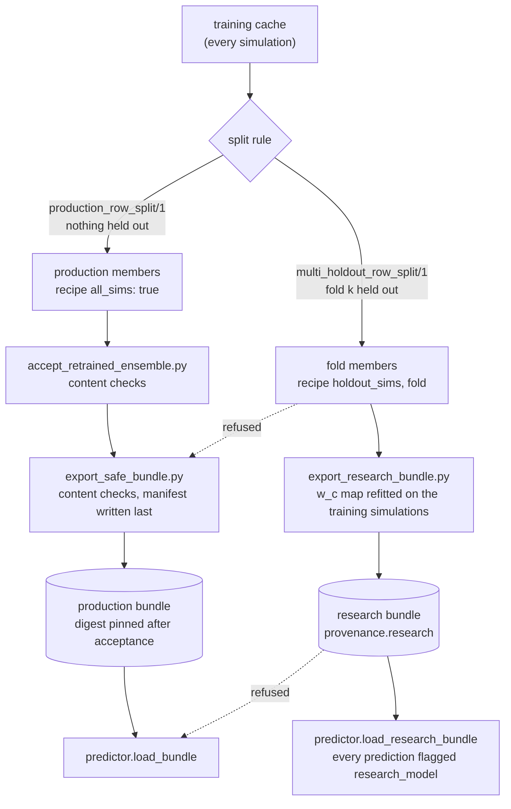

# Production and research model bundles: a hands-on tutorial

This tutorial explains how `hcd_priya` keeps two kinds of trained emulator apart:

- a **production model**, trained on every simulation of its training cache, which is what the public predictor serves
  to anyone fitting data; and
- a **research model**, for example one fold of a cross-validation, which is trained with some simulations held out so
  that its error can be measured on them.

Both are useful. Mixing them up is not: a fold model passed off as production silently drops part of the training set,
and a production model used to "validate" itself on simulations it was trained on reports an error that is too small.
The library therefore checks, at every load and again when a model is exported or accepted, which kind a model is, and
it refuses to load a research model through the production path.

You will:

1. load and verify a production bundle;
2. create, export, load and evaluate a research cross-validation bundle;
3. see what happens when a fold-trained model is passed to the production loader;
4. look at how the training and held-out splits and the fold-specific w_c maps are built;
5. go through the places where held-out information can leak, and how each is checked;
6. see why nothing here depends on today's number of simulations.

Every example below is executable. They run in a **synthetic world**: a made-up training cache of a few simulations
with made-up values, small networks, and made-up identities. None of the numbers mean anything physically; they show
the rules. To run them all and check that they still print what is shown here:

```bash
python docs/tutorials/run_tutorial.py --show      # from a repository checkout, with the package's environment
```

The test suite runs the same examples (`tests/test_tutorial_production_research.py`). The reference for the formats
is [`docs/release_format_h5.md`](../release_format_h5.md); the rules live in
`hcd_analysis/emulator/eligibility.py`.

## Words used here

- **Training cache**: the HDF5 file of simulated spectra the emulator is trained on, one row per (simulation, snapshot,
  mean-flux rescaling). Its sha256 identifies it.
- **Bundle**: a directory with the members (one HDF5 file and one JSON file each), the w_c map and a `manifest.json`
  that pins every file by sha256. The sha256 of `manifest.json` (the "manifest digest") identifies the whole bundle.
- **w_c map**: the small fitted map from the predicted absorber incidence dN/dX to the class fractions w_c (LLS,
  subDLA, DLA). It is fitted to the training simulations, so it is part of what a model "knows".
- **Normaliser**: the per-channel means and widths the network's targets are standardised with. It is fitted on the
  training rows only, so it is a fingerprint of the training set.
- **Recipe**: the dictionary of training settings each member records (`all_sims`, the held-out simulations, the fold,
  the split sizes, the learning knobs).

## The workflow at a glance



The same in plain text:

```text
  training cache ──┬── production split (all simulations) ──> production members ──> acceptance ──> release export
                   │                                                                                      │
                   │                                                         production bundle <──────────┘
                   │                                                                │
                   │                                                    predictor.load_bundle  (production only)
                   │                                                                ^
                   │                                                                x  refused
                   └── fold split (fold k held out) ──> fold members ──> research export ──> research bundle
                                                                                               │
                                                                     predictor.load_research_bundle (research only)
```

Two independent layers decide which kind a model is:

- **metadata rules**, checked at every load: what each member's recipe declares (cheap; they catch honest mistakes
  and mislabelled recipes, not deliberate forgery);
- **content checks**, run at export and acceptance where the training cache is available: the split, the normaliser
  and the w_c map are recomputed from the cache and compared with what the bundle holds (they catch a model whose
  content does not match what its recipe claims).

The final defence against substitution is the published manifest digest, pinned after a recorded acceptance: a loader
is always given the digest it must find.

## Setting up the synthetic world

The examples share one namespace and run in a temporary directory. The first block builds the synthetic world: a
release-format training cache of five simulations (`sim0` ... `sim4`), its w_c map, and one helper that saves a member
the way the trainers do. Release-grade products record the code that made them and require a clean, committed
checkout; here a made-up clean identity stands in for yours (in a real run, your checkout's own identity is used and
nothing is replaced). The made-up simulations' parameters lie outside the PRIYA design box, so the strict cache reader
prints a `WARN load_cache` line each time it reads the cache; that is expected here.

<!-- example: setup -->
```python
import json
import os
import warnings

import jax
import numpy as np

import hcd_analysis.predictor as hp
from hcd_analysis import lineage
from hcd_analysis.emulator import eligibility as E
from hcd_analysis.emulator import release_testing as RT
from hcd_analysis.emulator import safe_h5 as H
from hcd_analysis.emulator import train as T
from hcd_analysis.emulator import wc_map as W
from hcd_analysis.emulator.data import load_cache, multi_holdout_row_split, production_row_split
from tests.emulator._fixture import write_synthetic_cache_v34    # the test suite's synthetic cache writer

MADE_UP_CLEAN_CHECKOUT = {"commit": "c" * 40, "dirty": False}
lineage.code_identity = lambda repo_dir=None: dict(MADE_UP_CLEAN_CHECKOUT)

write_synthetic_cache_v34("cache.h5", n_sims=5, snaps_per_sim=4)  # 5 simulations x 4 snapshots x 4 mean-flux rungs
d = load_cache("cache.h5")                                         # the strict release reader
W.build("cache.h5", "wc_map.json")                                 # the w_c map refitted on the whole cache
ARCH = {"in_dim": 10, "n_k": 8, "n_basis": 4}
KNOBS = {"epochs": 2, "patience": 2, "w_coh": 0.0, "val_seed": 12345, "val_frac": 0.1}


def train_and_save(prefix, recipe, train_idx, val_idx, seed):
    """Train one small member on the training rows and save it as a release checkpoint (as the trainers do)."""
    model, norm, hist = T.train_fold(d, train_idx, val_idx, n_basis=4, epochs=2, batch_size=64, seed=seed,
                                     patience=2, prefit_baseline_epochs=0)
    T.save_checkpoint(prefix, model, ARCH, norm, seed, cache=d, cache_path="cache.h5", recipe=recipe, release=True,
                      code=MADE_UP_CLEAN_CHECKOUT)
    with open(prefix + ".hist.json", "w") as fh:
        json.dump({k: np.asarray(v).tolist() for k, v in hist.items()}, fh)


def sha256sums(prefixes, path):
    """A SHA256SUMS file listing every checkpoint file of the members (it pins them for the export)."""
    with open(path, "w") as fh:
        for p in prefixes:
            for ext in (".eqx", ".norm.pkl", ".meta.json"):
                fh.write(f"{lineage.sha256_file(p + ext)}  {os.path.basename(p + ext)}\n")
    return lineage.sha256_file(path)


sims = sorted(set(d["sim_name"].tolist()))
print("simulations in the cache:", sims)
print("rows:", d["sim_name"].size)
```

<!-- expected: setup -->
```text
WARN load_cache: 80/80 rows out of PRIYA param domain (params_unit outside [0,1])
WARN load_cache: 80/80 rows out of PRIYA param domain (params_unit outside [0,1])
simulations in the cache: ['sim0', 'sim1', 'sim2', 'sim3', 'sim4']
rows: 80
```

## 1. Loading and verifying a production bundle

A production bundle is loaded with its published manifest digest. In this synthetic world we write a small,
self-consistent production bundle first (`release_testing.write_synthetic_bundle`; a real one comes from
`scripts/export_safe_bundle.py`, below), then load it the way a user would.

<!-- example: production_load -->
```python
prod = RT.write_synthetic_bundle("production_bundle", n_members=2)
digest = prod.manifest_sha256                  # in real life: the digest published with the release

emu = hp.load_bundle("production_bundle", digest)
print("type:", type(emu).__name__, "| members:", emu.n_members)
print("lineage eligible:", emu.lineage["release_eligible"], "| reasons:", emu.lineage["ineligible_reasons"])

rb = H.load_release("production_bundle", expected_manifest_sha256=digest)
print("kind:", rb.kind, "| release_verified:", rb.release_verified)
print("every member declares all_sims:", all(m["recipe"]["all_sims"] is True for m in rb.metas))

params = {n: 0.5 * (lo + hi) for n, (lo, hi) in zip(hp.PARAM_NAMES, hp.PARAM_LIMITS)}
with np.errstate(all="ignore"):                # untrained synthetic networks: the values mean nothing
    pred = emu.predict(params, z=3.0, tau_eff=0.36)
print("P_class:", pred.P_class.shape, "| research_model flag present:", "research_model" in pred.flags)

for wrong in (None, "0" * 64):
    try:
        hp.load_bundle("production_bundle", wrong)
    except H.SafeFormatError as e:
        print("refused:", str(e).replace(os.getcwd() + os.sep, "").split(";")[0])
```

<!-- expected: production_load -->
```text
type: Bundle | members: 2
lineage eligible: True | reasons: []
kind: release | release_verified: True
every member declares all_sims: True
P_class: (4, 8) | research_model flag present: False
refused: load_bundle needs the published manifest sha256
refused: production_bundle/manifest.json: sha256 does not match the expected digest
```

What was verified on the way: the manifest bytes hash to the digest you gave; every file hashes to the manifest; the
lineage block names an eligible training cache, the finder, the commit and the w_c map; every member is tied to that
cache and commit; every member is a **production member** (its recipe declares `all_sims: true`, holds no held-out or
fold key and no research marking); and `predictor.Bundle` recomputes all of this itself rather than trusting stored
flags.

**With the published release (optional, not executed here).** The real bundle is not shipped with the code; when you
have it, the same call applies, with the digest published with the release:

```python
emu = hp.load_bundle("<the release bundle directory>", "<the published manifest sha256>")
assert emu.manifest_sha256 == "<the published manifest sha256>" and emu.lineage["release_eligible"]
```

`sha256sum <the release bundle directory>/manifest.json` shows the digest the loader will check. The repository's
integration tests (`tests/integration/`, run locally against the release data, not in CI) load the accepted bundle this
way and check that its predictions are bitwise those recorded before these rules were added.

## 2. Creating, exporting, loading and evaluating a research cross-validation bundle

A cross-validation fold holds some simulations out. Here fold 0 holds out `sim3`. The split rule
`multi_holdout_row_split/1` removes every row of the held-out simulations, then takes a fixed random 10% of the remaining
rows as the validation rows (used only to stop training early). The members record the split in their recipe.

<!-- example: research_train -->
```python
held_out = ["sim3"]
train_idx, val_idx, held_idx = multi_holdout_row_split(d["sim_name"], held_out, val_seed=12345, val_frac=0.1)
with open("folds.json", "w") as fh:
    json.dump({"folds": {"fold0": held_out}}, fh)
folds_digest = lineage.sha256_file("folds.json")

recipe = dict(KNOBS, all_sims=False, holdout_sim=None, holdout_sims=held_out, fold=0, folds_sha256=folds_digest,
              n_train=int(train_idx.size), n_val=int(val_idx.size))
os.makedirs("fold0", exist_ok=True)
fold_prefixes = [f"fold0/cv_fold0_seed{s}" for s in (0, 1)]
for s, prefix in enumerate(fold_prefixes):
    train_and_save(prefix, recipe, train_idx, val_idx, seed=s)
sums_digest = sha256sums(fold_prefixes, "fold0/SHA256SUMS")

print("rows: train", train_idx.size, "| validation", val_idx.size, "| held out", held_idx.size)
print("held-out simulations in the training rows:", sorted(set(d["sim_name"][train_idx]) & set(held_out)))
print("members saved:", [os.path.basename(p) for p in fold_prefixes])
```

<!-- expected: research_train -->
```text
rows: train 58 | validation 6 | held out 16
held-out simulations in the training rows: []
members saved: ['cv_fold0_seed0', 'cv_fold0_seed1']
```

The research export writes the bundle. It takes the split **explicitly** on the command line and checks it against
every member and against the cache; it never infers the training set from a label alone. It refits the w_c map on the
training simulations only, so the held-out simulation never enters it. Below the script is run in-process; the command
line is the same.

<!-- example: research_export -->
```python
import contextlib
import importlib.util
import io

spec = importlib.util.spec_from_file_location("export_research_bundle",
                                              os.path.join(REPO, "scripts", "export_research_bundle.py"))
X = importlib.util.module_from_spec(spec)
spec.loader.exec_module(X)
argv = ["--out", "research_out", "--purpose", "fold 0 of a synthetic cross-validation",
        "--split-rule", "multi_holdout_row_split/1", "--held-out-sim", "sim3", "--fold", "0",
        "--folds-digest", folds_digest, "--fold-file", "folds.json", "--fold-file-sha256", folds_digest,
        "--sha256sums", "fold0/SHA256SUMS", "--sha256sums-sha256", sums_digest,
        "--cache", "cache.h5", "--cache-sha256", lineage.sha256_file("cache.h5")]
for p in fold_prefixes:
    argv += ["--member", p]
log = io.StringIO()
with warnings.catch_warnings(), contextlib.redirect_stdout(log):
    warnings.simplefilter("ignore")
    status = X.main(argv)
print("\n".join(line for line in log.getvalue().splitlines() if line.startswith(("ok", "FAIL"))))
summary = json.load(open("research_out/evidence/research_export_summary.json"))
research_digest = summary["bundle_manifest_sha256"]  # it changes with every export (it pins the creation time)
print("exit status:", status, "| verdict:", summary["verdict"])
```

<!-- expected: research_export -->
```text
ok   research_load
ok   m0_leaves
ok   m0_meta
ok   m1_leaves
ok   m1_meta
ok   norm
ok   ensemble_P_filt
ok   research_predictor
ok   production_loaders_refuse
exit status: 0 | verdict: PASS
```

Each line is one check after writing: the research loader reads the bundle, the members' leaves, metas and
normaliser are bitwise the training checkpoints', the ensemble prediction is bitwise the checkpoints', the research
predictor loads it, and every production loader refuses it.
Now load it as a user would, through the research path. A research load always needs the digest and a purpose (why
you load it; it is logged and kept).

<!-- example: research_load -->
```python
rp = hp.load_research_bundle("research_out/bundle", research_digest, purpose="evaluate the held-out simulation")
print("type:", type(rp).__name__, "| is a production Bundle:", isinstance(rp, hp.Bundle))
print("bundle purpose:", rp.purpose)
print("split:", {k: rp.split[k] for k in ("rule", "held_out_sims", "fold", "n_train", "n_val")})
print("content checks:", {c["component"]: c["outcome"] for c in rp.research["content_checks"]})
print("w_c map fitted on", rp.research["wc_map"]["n_sims"], "simulations, rule", rp.research["wc_map"]["rule"])
```

<!-- expected: research_load -->
```text
type: ResearchPredictor | is a production Bundle: False
bundle purpose: fold 0 of a synthetic cross-validation
split: {'rule': 'multi_holdout_row_split/1', 'held_out_sims': ['sim3'], 'fold': 0, 'n_train': 58, 'n_val': 6}
content checks: {'cache': 'PASS', 'split': 'PASS', 'normaliser': 'PASS', 'wc_map': 'PASS'}
w_c map fitted on 4 simulations, rule wcmap_refit_subset/1
```

To evaluate the fold, predict at the held-out simulation's own parameters and compare with its spectra in the cache.
Every research prediction carries `research_model: True`, so it cannot be mistaken for a production prediction later.

<!-- example: research_evaluate -->
```python
rows = held_idx[:4]
residuals = []
with np.errstate(all="ignore"):
    for r in rows:
        theta = dict(zip(hp.PARAM_NAMES, d["params"][r].tolist()))
        z = round(float(d["z_grid"][r]), 1)
        pred = rp.predict(theta, z, tau_eff=float(d["tau0"][r]))
        residuals.append(pred.P_class[0] / d["P_filt"][r, 0] - 1.0)   # clean class, at the native modes
print("held-out rows evaluated:", len(rows), "| residual array shape:", np.shape(residuals))
print("research_model:", pred.flags["research_model"], "| held out:", pred.flags["research_split"]["held_out_sims"])
print("label:", pred.labels["model"])
```

<!-- expected: research_evaluate -->
```text
held-out rows evaluated: 4 | residual array shape: (4, 8)
research_model: True | held out: ['sim3']
label: a RESEARCH model (fold 0 of a synthetic cross-validation; split multi_holdout_row_split/1, held out ['sim3']): never a production model
```

(The networks here are trained for two epochs on made-up data, so the residuals mean nothing; the point is that the
held-out rows were never seen by the members, the normaliser or the w_c map.)

## 3. A fold-trained model passed to the production loader

What if someone passes the fold bundle to `predictor.load_bundle`? It is refused, with a reason.

<!-- example: refusal_research_bundle -->
```python
try:
    hp.load_bundle("research_out/bundle", research_digest)
except H.SafeFormatError as e:
    print(type(e).__name__ + ":", str(e).split(": ", 1)[1])
```

<!-- expected: refusal_research_bundle -->
```text
SafeFormatError: a research bundle (provenance.research) is never a production model; it loads only through safe_h5.load_research / predictor.load_research_bundle
```

That bundle was marked research. A more dangerous mistake is to write fold members through the library writers as
if they were a production bundle, with no research marking at all. The loader still refuses: it reads each member's
recipe and recomputes the eligibility, and every reason carries a stable code you can test for.

<!-- example: refusal_fold_members -->
```python
os.makedirs("mislabelled", exist_ok=True)
members = [T.load_checkpoint(p) for p in fold_prefixes]
for p, (model, meta, norm) in zip(fold_prefixes, members):
    H.export_member(os.path.join("mislabelled", os.path.basename(p)), model, meta, norm)
wcm = H.export_wc_map("mislabelled", "wc_map.json")
block = H.make_lineage_block(cache_record=d["lineage"], cache_identity={"sha256": d["cache_sha256"],
                             "size": os.path.getsize("cache.h5")}, wc_map=wcm,
                             member_metas=[m for _, m, _ in members], export_code=MADE_UP_CLEAN_CHECKOUT)
path = H.write_manifest("mislabelled", [os.path.join("mislabelled", os.path.basename(p)) for p in fold_prefixes],
                        {"source": "fold members written as if production"}, lineage=block)
print("release_eligible:", block["release_eligible"])
print("reason codes:", sorted({E.reason_code(r) for r in block["ineligible_reasons"]}))
try:
    hp.load_bundle("mislabelled", H.sha256_file(path))
except H.SafeFormatError as e:
    print("refused:", "does not establish a clean release" in str(e))
```

<!-- expected: refusal_fold_members -->
```text
release_eligible: False
reason codes: ['ALL_SIMS_NOT_TRUE', 'RSV_KEY:recipe.fold', 'RSV_KEY:recipe.folds_sha256', 'RSV_KEY:recipe.holdout_sims']
refused: True
```

The reason codes say what was found: `ALL_SIMS_NOT_TRUE` (the recipe does not declare the full training set) and one
`RSV_KEY:<path>` for each reserved held-out or fold key (`recipe.holdout_sims`, `recipe.fold`,
`recipe.folds_sha256`). The same codes appear if somebody edits the manifest to say "eligible": the loader recomputes
from the members and refuses anyway.

What if the recipe itself is edited to look like production (the fold keys deleted, `all_sims: true`)? The metadata
rule cannot see through that, by design: it reads what the recipe says. The content checks at export and acceptance
can, because the normaliser and the split sizes are fingerprints of the rows the model was really trained on:

<!-- example: refusal_relabelled -->
```python
relabelled = []
for _, meta, norm in members:
    r = {k: v for k, v in meta["recipe"].items() if k not in ("holdout_sims", "fold", "folds_sha256")}
    r["all_sims"] = True
    relabelled.append((dict(meta, recipe=r), norm))
print("metadata rule reasons:", E.production_recipe_reasons(relabelled[0][0]))
check = E.production_content_check([m for m, _ in relabelled], [n for _, n in relabelled], W.read_wc_map("wc_map.json"),
                                   cache=d, cache_path="cache.h5", expected_cache_sha256=d["cache_sha256"])
print("content checks:", check.outcomes(), "| passed:", check.passed)
```

<!-- expected: refusal_relabelled -->
```text
metadata rule reasons: []
content checks: {'cache': 'PASS', 'split': 'MISMATCH', 'normaliser': 'UNAVAILABLE', 'wc_map': 'PASS'} | passed: False
```

The split sizes the recipe records are a fold's, not the full cache's, so the split component is MISMATCH and the
production export and acceptance refuse the members. (Had the sizes been forged too, the normaliser, fitted on the
fold's rows, would be the MISMATCH.) Nothing at load time detects deliberately forged metadata whose digest was
recomputed; that is what the published digest of an accepted release is for.

## 4. Training and held-out splits, and fold-specific w_c maps

The split rules are library functions, versioned by name, and every check recomputes them from the cache:

<!-- example: splits -->
```python
tr0, va0, _ = production_row_split(d["sim_name"], val_seed=12345, val_frac=0.1)
trm, vam, _ = multi_holdout_row_split(d["sim_name"], [], val_seed=12345, val_frac=0.1)
print("multi-holdout with nothing held out == production split:", np.array_equal(tr0, trm) and np.array_equal(va0, vam))
for held in (["sim3"], ["sim1", "sim4"]):
    tr, va, ho = multi_holdout_row_split(d["sim_name"], held)
    print(held, "| train", tr.size, "| validation", va.size, "| held out", ho.size,
          "| disjoint:", not (set(tr) & set(va) or set(tr) & set(ho) or set(va) & set(ho)))
```

<!-- expected: splits -->
```text
multi-holdout with nothing held out == production split: True
['sim3'] | train 58 | validation 6 | held out 16 | disjoint: True
['sim1', 'sim4'] | train 44 | validation 4 | held out 32 | disjoint: True
```

The validation rows come from the training simulations only: they decide when training stops, so they must not
include a held-out simulation either.

The w_c map is fitted to simulations. A fold's map must be refitted on that fold's training simulations;
`wc_map.refit_subset` does it on a view of the cache that holds nothing else, and with every simulation it is the full
refit byte for byte:

<!-- example: fold_maps -->
```python
full = W.refit(d)
fold = W.refit_subset(d, ["sim0", "sim1", "sim2", "sim4"])
same = W.refit_subset(d, sims)
print("simulations in the full map:", full["delta_c"]["n_sims"], "| in the fold map:", fold["delta_c"]["n_sims"])
print("fold map differs from the full map:", fold["delta_c"]["coeffs"] != full["delta_c"]["coeffs"])
print("refit_subset on every simulation is refit:", lineage.canonical_json(same) == lineage.canonical_json(full))
view = W.training_view(d, ["sim0", "sim1", "sim2", "sim4"])
print("simulations the fold view can see:", sorted(set(view["sim_name"].tolist())))
print("the research bundle records:", {k: rp.research["wc_map"][k] for k in ("rule", "n_sims")},
      "| its training set digest is the fold's:",
      rp.research["wc_map"]["fitted_on_sims_sha256"] == E.sims_sha256(["sim0", "sim1", "sim2", "sim4"]))
```

<!-- expected: fold_maps -->
```text
simulations in the full map: 5 | in the fold map: 4
fold map differs from the full map: True
refit_subset on every simulation is refit: True
simulations the fold view can see: ['sim0', 'sim1', 'sim2', 'sim4']
the research bundle records: {'rule': 'wcmap_refit_subset/1', 'n_sims': 4} | its training set digest is the fold's: True
```

The map file format does not change: which simulations a map was fitted on is recorded by the research bundle
(`provenance.research.wc_map`), so a fold map file is not self-describing outside its bundle. The production export's
map check is what catches a fold map placed in a production bundle.

## 5. Avoiding leakage in training, validation and export

Held-out information can leak in at four places. Each has a check.

**(a) The normaliser is fitted on the training rows only.** `train.train_fold` fits it with `train._fit_norm(d,
train_idx)`. Changing the validation rows' spectra does not change it:

<!-- example: leak_normaliser -->
```python
from hcd_analysis.emulator import safe_io
poisoned = {k: (np.array(v, copy=True) if isinstance(v, np.ndarray) else v) for k, v in d.items()}
poisoned["P_filt"][val_idx] *= 1000.0
a = safe_io.norm_tensors(T._fit_norm(d, train_idx))
b = safe_io.norm_tensors(T._fit_norm(poisoned, train_idx))
print("normaliser unchanged by the validation rows:", all(a[k].tobytes() == b[k].tobytes() for k in a))
c = safe_io.norm_tensors(T._fit_norm(d, np.arange(d["sim_name"].size)))
print("fitted on every row instead, tensors that differ:", sum(a[k].tobytes() != c[k].tobytes() for k in a), "of", len(a))
```

<!-- expected: leak_normaliser -->
```text
normaliser unchanged by the validation rows: True
fitted on every row instead, tensors that differ: 25 of 25
```

**(b) The validation rows never include a held-out simulation** (section 4).

**(c) The w_c map of a fold never sees its held-out simulations** (section 4). The research content check catches a
fold bundle that carries the full-cache map:

<!-- example: leak_wc_map -->
```python
fold_members = [T.load_checkpoint(p) for p in fold_prefixes]
leaky = E.research_content_check([m for _, m, _ in fold_members], [n for _, _, n in fold_members],
                                 W.read_wc_map("wc_map.json"), rp.research, cache=d, cache_path="cache.h5",
                                 expected_cache_sha256=d["cache_sha256"])
print("with the full-cache map:", leaky.outcomes()["wc_map"])
print("with the fold's own map:", rp.research["content_checks"][3]["outcome"])
```

<!-- expected: leak_wc_map -->
```text
with the full-cache map: MISMATCH
with the fold's own map: PASS
```

**(d) Choices taken from a cross-validation** (for example the number of epochs of a final model, chosen from the
folds) are allowed in a production model, but they are recorded in a closed schema, `recipe.cv_selection`, whose keys
avoid every held-out or fold name. A fold list smuggled into it is refused:

<!-- example: leak_selection -->
```python
honest = dict(KNOBS, all_sims=True, epochs=2, n_train=72, n_val=8,
              cv_selection={"schema": "cv_selection/1", "source_cv_set_id": "synthetic 5-fold set",
                            "source_folds_digest": folds_digest,
                            "derived": {"epochs": {"value": 2, "rule": "median restored epoch over the folds"}}})
print("honest selection record:", E.production_recipe_reasons({"recipe": honest}))
smuggled = dict(honest, cv_selection=dict(honest["cv_selection"], holdout_sims=["sim3"]))
print("smuggled fold list:", sorted({E.reason_code(r) for r in E.production_recipe_reasons({"recipe": smuggled})}))
```

<!-- expected: leak_selection -->
```text
honest selection record: []
smuggled fold list: ['CV_SELECTION', 'RSV_KEY:recipe.cv_selection.holdout_sims']
```

Two more rules close the export: the content checks run on the objects **actually written** (the files are read back
before the manifest exists), and the manifest is written **last**, so a failed check never leaves a loadable bundle.

## 6. A future, larger simulation set

Nothing here assumes how many simulations there are. "Trained on every simulation" means every simulation of the
cache the members were trained on, as that cache's own rows say. To add simulations you build a new cache; members
trained on it are checked against it:

<!-- example: future_set -->
```python
write_synthetic_cache_v34("cache_more.h5", n_sims=8, snaps_per_sim=4, seed=11)
d8 = load_cache("cache_more.h5")
W.build("cache_more.h5", "wc_map_more.json")
tr8, va8, _ = production_row_split(d8["sim_name"])
metas8 = [{"cache_sha256": d8["cache_sha256"], "recipe": dict(KNOBS, all_sims=True, holdout_sim=None,
                                                              n_train=int(tr8.size), n_val=int(va8.size))}]
check8 = E.production_content_check(metas8, [T._fit_norm(d8, tr8)], W.read_wc_map("wc_map_more.json"), cache=d8,
                                    cache_path="cache_more.h5", expected_cache_sha256=d8["cache_sha256"])
split8 = [c for c in check8["components"] if c["component"] == "split"][0]["detail"]
print("simulations in the new cache:", split8["n_sims_in_cache"], "| covered by the training rows:",
      split8["n_train_sims"], "| passed:", check8.passed)
old = E.production_content_check(metas8, [T._fit_norm(d8, tr8)], W.read_wc_map("wc_map.json"), cache=d,
                                 cache_path="cache.h5", expected_cache_sha256=d["cache_sha256"])
print("the same members checked against the old cache:", old.outcomes()["cache"])
```

<!-- expected: future_set -->
```text
WARN load_cache: 128/128 rows out of PRIYA param domain (params_unit outside [0,1])
WARN load_cache: 128/128 rows out of PRIYA param domain (params_unit outside [0,1])
simulations in the new cache: 8 | covered by the training rows: 8 | passed: True
the same members checked against the old cache: MISMATCH
```

The fold rule works the same way on any set: a fold file lists the held-out simulations of each fold, and a larger
cache simply has more simulations to partition. A production model built on the larger cache is a new model: new
cache, new training, new acceptance, new export, and a new published digest.

## Summary of the loaders

| you want | call | you get | it refuses |
|---|---|---|---|
| a production model | `predictor.load_bundle(dir, digest)` | `Bundle` | research bundles, fold members, ineligible lineage, no digest |
| the same, lower level | `safe_h5.load_release(dir, expected_manifest_sha256=...)` | `ReleaseBundle` (`kind` "release") | the same |
| a research model | `predictor.load_research_bundle(dir, digest, purpose=...)` | `ResearchPredictor` | production bundles, no purpose, no digest |
| the same, lower level | `safe_h5.load_research(dir, expected_manifest_sha256=..., purpose=...)` | `ResearchBundle` (`kind` "research") | the same |
| a quick development look | `safe_h5.load_ensemble(dir, expected_manifest_sha256=None)` | ensemble, metas (`kind` "dev") and a warning | nothing about lineage |

## Limits to keep in mind

- The metadata rules guard against accidents, not forgery: a deliberately rewritten recipe with a recomputed digest
  passes them. The content checks catch a split, normaliser or w_c map that does not match the declared training set,
  but they need the training cache and they verify the normaliser's rows, not the network weights.
- The reserved key list is a list. A new spelling of "held out" outside it passes the loader; the content checks still
  see the training rows.
- Research bundles need a release-grade cache. Research on other caches stays on the training checkpoints.
- A full-simulation research model trained without `recipe.research` looks like a production member to every rule.
